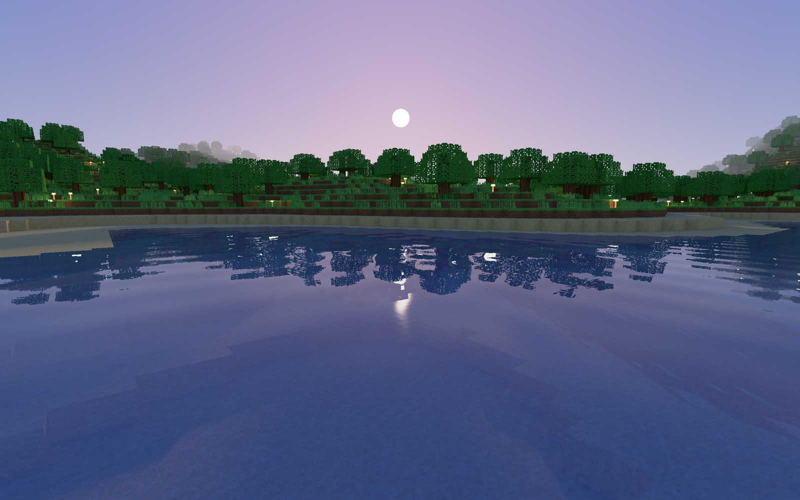
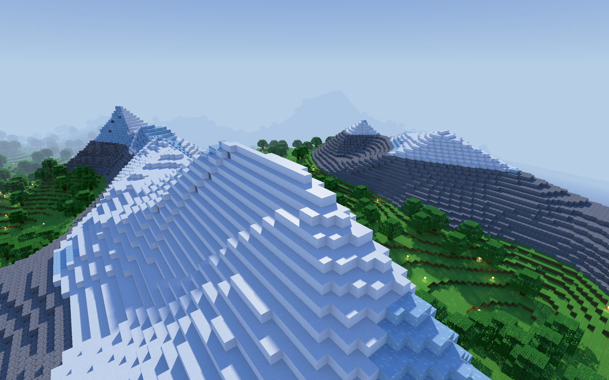
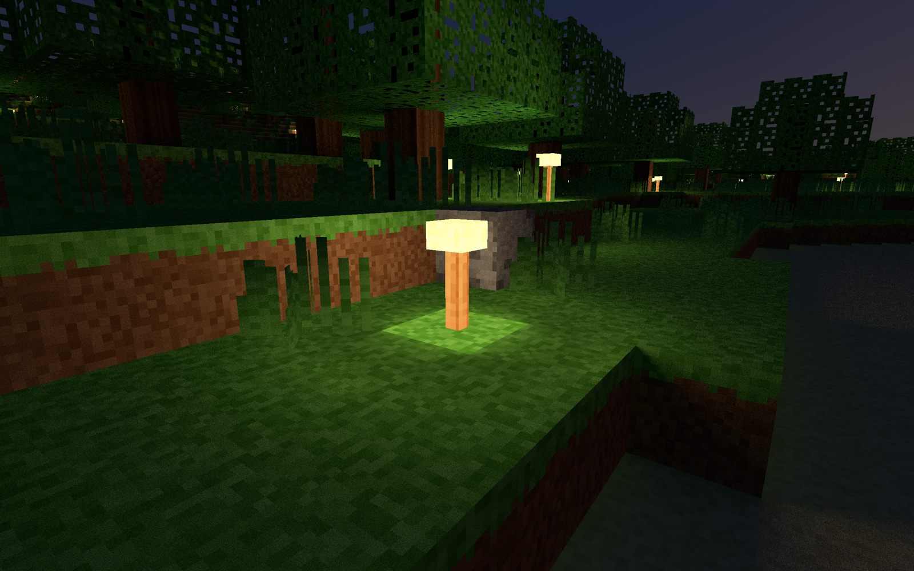
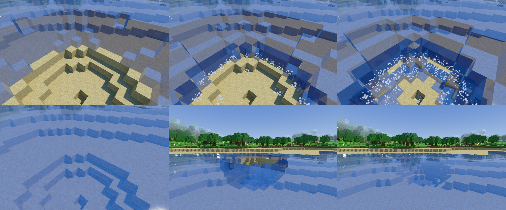
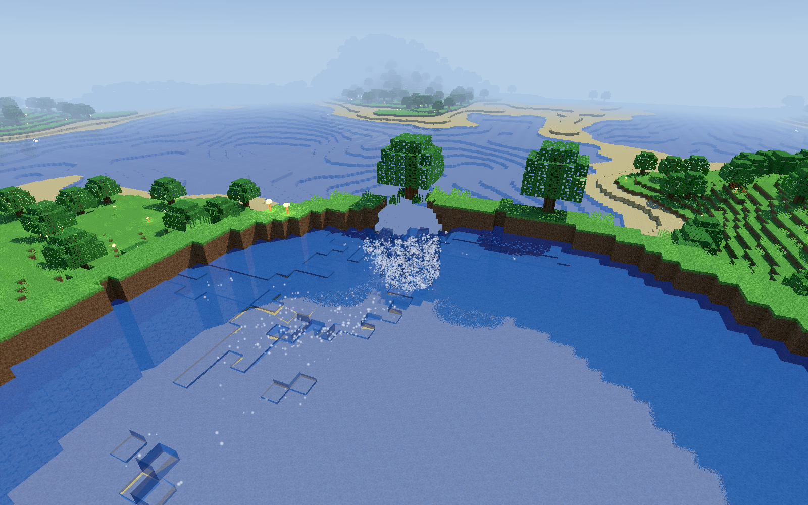
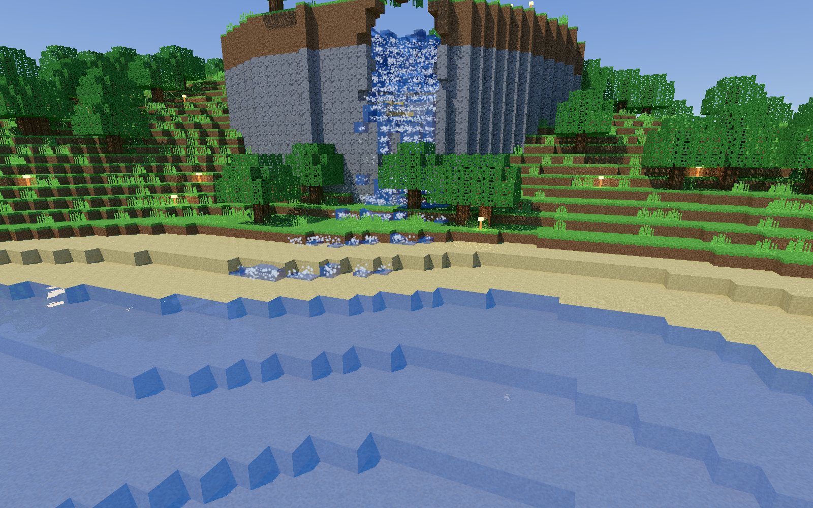
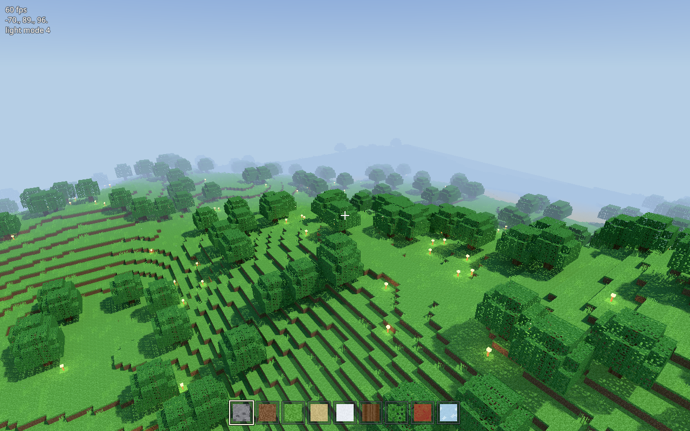
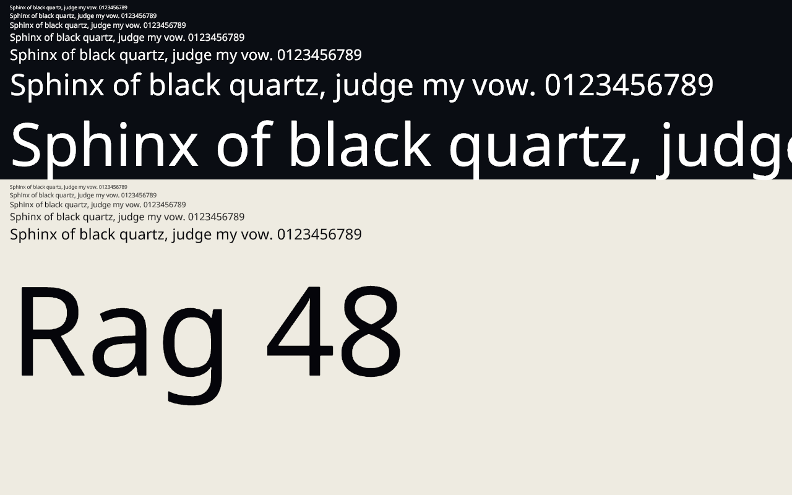
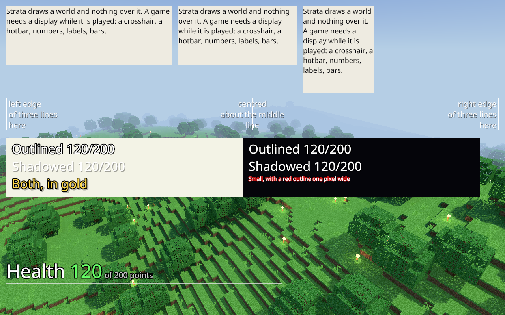
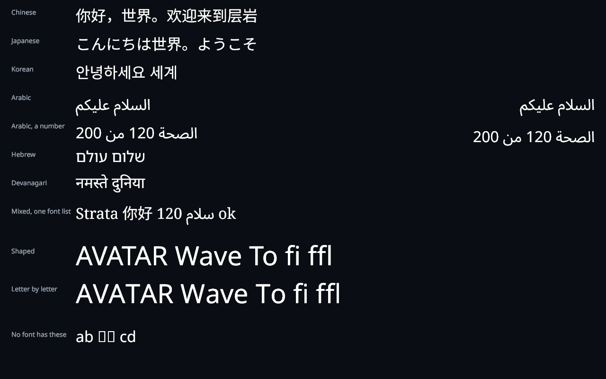

# Strata

A voxel engine library for March: a block registry, 32-cubed palette chunks,
a greedy mesher that emits 8-byte quads, and a Vulkan renderer that draws
them from one large GPU buffer. Games supply blocks and terrain; Strata names
no game concept.

Design: `docs/2026-11-10-strata-design.md`. Build plan:
`docs/2026-11-10-strata-voxel-core.md`.

## Toolchain

Strata compiles against March `origin/main` (as of `f6481bbe6`, march
0.7.0). `scripts/env.sh` puts a build of it first on the path (at
`~/code/march-main`, a git worktree of the March repository built with
`dune build`; set `STRATA_MARCH_HOME` to point elsewhere) and sets
`MARCH_HOME` to an empty directory there, because forge otherwise takes the
toolchain `~/.march/current` names (0.5.0 on the development machine) ahead
of the one on the path. March 0.5.0 no longer builds Strata: file, settings
and print calls answer a capability result (`Authority.must`), and hashes
use `int_wrapping_mul`, neither of which 0.5.0 has. The numbers in
`RESULTS.md` up to the island's are from 0.5.0; those of path finding are
from main.

The renderer needs Vulkan and GLFW. On macOS:

    brew install molten-vk vulkan-loader vulkan-headers glfw

`glslang` is needed only to rebuild `native/strata_shaders.h` after editing
the shaders (`native/build_shaders.sh`).

## Running it

    viewer/run.sh            # walk a generated world
    cd demo && forge build --release && ./.march/build/release/strata_demo

In the viewer: W A S D move, the mouse looks, space jumps, F switches
between walking and flying (space and left shift then rise and sink), left
click blasts a crater (with a spray in the colour of what it threw up),
right click builds a sphere, escape quits. Blast the rim of a lake in the
hills and it drains. `L` steps through the light modes, `[` and `]` lower
and raise the sun, and `R` rereads the island's settings and regenerates.

## The island

The world is an island 2 km across, read from `Strata.Atlas`: rivers run
to the sea in their channels and lakes stand at their spill level. Under
its surface the land is a 3D density (`Strata.Lattice`) with overhangs and
caves that open here and there, its steepest slopes relaxed to scree
(`Strata.Thermal`), grass over dirt over stone laid by `Strata.Surface`.
Trees, grown at start-up by a procedural branching generator (oak, birch,
pine, willow), stand across chunk borders; ruins stand on the atlas's sites
with the ground pulled up to them; posts and tall grass stand on the grass.
All four are declared in `viewer/assets/island.pop` and placed by the
population (see Population below).

**The atlas cache.** The atlas is one pass over the whole island (height,
erosion, drainage, rivers, lakes, regions, sites); at 512 x 512 samples it
takes seconds to build, so `Strata.Atlas.load_or_build(dir, def, seed)` keeps
it in `dir` (the viewer's `.march/atlas`) under a name made from the
definition and the seed, and reads it back in tens of milliseconds. Change a
setting of the definition and a new atlas is built beside the old.

**The generator calls a game makes.** A generator is a pure function of a
chunk key and a seed, and may carry a second one, its stamps:

```march
-- the chunk function, and the replay of its template pass alone
let g = Strata.Terrain.with_stamps(Strata.Terrain.gen(fn (k, seed) -> chunk(k, seed)),
                                   Strata.Terrain.Stamps(fn (k, seed) -> stamps(k, seed)))
let w = Strata.World.new(reg, g, seed, 0.25)          -- metres a voxel

-- which voxels of a chunk a placed structure wrote: its index + 1, 0 for none
let st = Strata.Terrain.stamps(g, k, seed)            -- all zeros without stamps

-- a crater: a sphere whose radius varies by direction, up to 1.3 times
let o = Strata.Edit.blast(Strata.Stream.world(s), x, y, z, 6, crater_seed, 0)

-- tuning: drop every unedited chunk and remake it from a new generator
let s2 = Strata.Stream.regenerate(s, g2)
```

Stamps are not stored: a game asks for them when it needs them (a blast on
a ruin), and a stamped voxel that is now air was removed by an edit.

**The scale rule.** Everything the generator knows is in metres: lengths,
heights, noise periods. The world's scale (metres a voxel, given to
`Strata.World.new`) only decides how finely that shape is cut into voxels,
so the same seed makes the same island at any scale that divides a metre
(1 m, 0.5 m, 0.25 m a voxel): the ground, the water, the trees (the same
tree in the same cell, its slope measured over a metre each side), the
ruins (authored at 1 m a voxel and fitted with `Strata.Template.fit`, so a
ruin is as many metres across) and the lantern posts (rolled per square
metre) stand where they stand, in metres, to within a voxel of the coarser
scale; `viewer/test/island_test.march` checks it at 1 m and 0.5 m. Two
parts are still tuned at 1 m: the thermal scree (its reach is counted in
voxels, so a steep slope relaxes less at a finer scale) and the cave and
density sampling lattice (its spacing is in voxels). Voxel counts (a blast's
radius, a chunk's 32) stay voxels. The stream's focus and `Strata.Query.raycast` take metres;
the renderer, the camera, edits and `Strata.Fluid` work in voxels. The
viewer's fixed scenes are posed at 1 m; `STRATA_SCALE=0.25` runs it finer.

**The parameter file.** The viewer's generator settings (the atlas
definition, the detail and density noise, the cave thresholds, the surface
lines, the tree kind, each region's tree density, species mix and cave
factor) are lines of `viewer/assets/island.gen`, `name = value`, read at
start and again on `R` (or `STRATA_REGEN=1` in a scripted run). Some
numbers stay in the code: a site's radius (12 m) and the island mask's
relief (up to 60 m over the sea before erosion) in `Strata.Atlas`; and in the
viewer the reach of a lake's rim clamp (4 m), the room left over the ground
for trees and ruins (`feature_top`, 18 m), how far a tree may reach
(`max_reach`, 10 m), how far past an area rivers are looked for
(`reach_m`, 64 m), a river channel's depth (up to 1.5 m) and the tree
species' shapes (`StrataViewer.Trees`). A name the
file leaves out takes the code's default and is said once a load; a name it
does not know, or a line it cannot read, is said and ignored. Regenerating
first finishes the fluid's step in flight and starts the fluid afresh, then
drops every chunk nobody edited and makes it again.

Environment switches for scripted runs are listed at the top of
`viewer/lib/strata_viewer.march`: a fixed scene (`STRATA_SCENE`), a frame
count and screenshot (`STRATA_FRAMES`, `STRATA_SHOT`), offscreen timing
(`STRATA_OFFSCREEN=1`), view radius, window size, quad capacity.

    scripts/golden.sh            # render the fixed scenes and compare with test/golden/
    scripts/golden.sh --update   # re-store them; look at each before committing

`viewer/` is the renderer's test bed. `demo/` runs the core headless and
prints what it cost; see `RESULTS.md`.

## Lighting

Light is ray traced against the voxels themselves, on the GPU, so it follows
an edit on the frame the edit is drawn. Design:
`docs/2026-11-10-lighting-design.md`.

- The sun casts shadows. Leaves cast dappled shade from the holes in their
  texture.
- Smooth blocks mirror: water and ice reflect the land and the sky, and carry
  the sun's glint. Anything not fully rough carries a softer highlight.
- Open sky lights what it can see, so it is darker under a canopy or down a
  tunnel.
- Blocks that emit light the ground around them, in their colour.

A block's part in this is two registry fields a game already sets:
`Strata.Blocks.with_material(def, roughness, 0)` (0 a mirror, 255 fully
rough, the default) and `Strata.Blocks.with_emission(def, r, g, b, strength)`.

| Call | Does |
|---|---|
| `Strata.Render.set_light_box(radius_h, radius_v)` | sizes the lighting to the stream's radii; once, before the first `sync` |
| `Strata.Render.set_sun(dx, dy, dz, r, g, b)` | the direction to the sun and its colour; the sky and fog follow |
| `Strata.Render.set_time(seconds)` | drives the water's ripples |
| `Strata.Render.set_quality(sky_rays, reflections)` | sky rays per pixel per sample (0 to 8, default 2); mirror rays on or off |
| `Strata.Ffi.Vk.set_lighting(mode)` | 4 everything (the viewer's default), 3 without sky light, 2 shadows only, 1 no rays, 0 the old flat shading |

Costs and what misses its target are in `RESULTS.md`.





## Fluids

Water is a finite amount that moves. Dig out the bank of a lake and it runs
downhill, pools in any hollow, and otherwise carries on to the sea, while
the lake's surface drops as one level sheet. Design:
`docs/2026-11-10-fluid-design.md`.

A fluid is a family of eight block states, one per eighth of a voxel it
fills, so it is ordinary blocks changed by ordinary edits: meshing, lighting
and collision follow with no path of their own.

```march
-- eight states of water; a sea block that swallows what reaches it
let (reg1, lake) = match Strata.Blocks.register_fluid(reg0, water_def) do Ok(p) -> p  Err(_) -> (reg0, 0) end
let fluid0 = Strata.Fluid.new(reg1, Cons((lake, Strata.Fluid.flowing()), Cons((sea, Strata.Fluid.sink()), Nil)))

-- every edit the game makes: tell the fluid
let o = Strata.Edit.fill_sphere(Strata.Stream.world(s), x, y, z, 4, 0)
let s1 = Strata.Stream.apply(s, o)
let f1 = Strata.Fluid.wake(f, Strata.Edit.world(o), o)

-- ten times a second: end the step begun last time, begin the next
let (f2, s2) = Strata.Fluid.finish(job, f1, s1)
let (f3, job2) = Strata.Fluid.begin(f2, Strata.Stream.world(s2), focus)
-- Strata.Fluid.events(f2) says where water fell, how much, and how far: spray and sound
```

A step is worked out on a worker and costs the frame about half a
millisecond. `Strata.Fluid.step` does one at once instead, for tools and
tests. `Strata.Render.spray` draws particles that fly on the clock; the
viewer feeds it from the fluid's events.

A family is one of three kinds. `flowing` water moves and is finite. A
`sink` swallows what reaches it and never changes. A `sea` is a body that is
never used up: it swallows water that runs out over it, and it floods any
hole dug in it or beside it, up to its own level and no higher. Over a drop
it pours flowing water, so a cave under the seabed floods from above. An
edit that touches a sea must be passed to `Strata.Fluid.wake`, as for any
water. A cave flooded through its roof keeps some air under the roof.





## Sound

`Strata.Sound` is what a game hears, as a value: it plays, moves, retunes
and stops voices, and once a frame hands the frame's calls to the mixer in
`native/strata_audio.c` (miniaudio, vendored). The mixer runs on its own
thread and never waits for the frame, nor the frame for it. Design:
`docs/2026-11-11-audio-design.md`.

```march
let opened = Strata.Ffi.Audio.open(false)              -- speakers; false when there is no device
let (s1, strike) = Strata.Sound.upload(Strata.Sound.new(), Strata.Sound.strike())
let (s2, v) = Strata.Sound.play_flat(s1, strike, 0, 0.9, 0.0, 1.0)   -- group 0
let s3 = Strata.Sound.control(s2, v, 0, 0.8)           -- hardness

-- once a frame, last
let (s4, cmds) = Strata.Sound.update(s3, world, fluid, dt)
let _took = Strata.Ffi.Audio.send(cmds)
Strata.Ffi.Audio.advance(dt)                           -- mixes only when rendering in game time
```

A patch is built from fixed pieces (four sources, two filters, two
envelopes, two modulators, four live controls): `Strata.Sound.patch()` and
its `with_*` calls. `Strata.Ffi.Audio.render(path)` renders in game time to
a WAV with no device; `scripts/audio_golden.sh` renders `soundcheck/`'s
scenes that way and compares their loudness by band with
`test/golden-audio/`. The gate opens no device.

In the viewer, `STRATA_AUDIO=0`, `1`, `null` or `wav:path` turn sound off,
on, onto the silent null device, or into a file; scripted runs default to
off. Carving and building strike where they land; `H` switches between
headphones and speakers; `N` places a recording from `viewer/sounds/` (WAV,
FLAC, MP3: the repository ships none) five metres ahead.

Placed sound: `Strata.Sound.listener` once a frame (the camera), `play` at
a point, `move`, and `with_range(reference, maximum)`: full within the
reference distance, 6 dB quieter for each doubling beyond it, silent past
the maximum. Air dulls far sound. On speakers a voice is panned; on
headphones every voice goes into a third-order ambisonic field turned into
two ears by head-related filters (`native/strata_hrir.h`, generated by
`native/tools/make_hrir.c` from the MIT KEMAR measurements in
`native/hrir/`: Bill Gardner and Keith Martin, "HRTF Measurements of a KEMAR
Dummy-Head Microphone", MIT Media Lab Technical Report #280, 1994). 64 voices are
mixed; up to 1024 are tracked, the quietest at the listener (times a
priority) kept in time but not computed.

The blocks muffle sound. `Strata.Blocks.with_sound(def, absorption, loss,
damping)` says how a block treats it (a block that says nothing takes a
default from its opacity: stone cuts 25 dB a metre, glass and leaves 4,
water 10). Ten times a second, on a worker, `Strata.Acoustics` walks five
paths from the listener to each placed voice (the straight line and four
moved a metre aside) and the least obstructed decides how quiet and how dull
it is; a voice is walked once more the frame it starts, so it never plays
clear for a moment behind a wall. Unloaded chunks are air.

The space around the listener decides the echo. The same job casts 64 rays
from the listener to 64 m: how many escape (open sky) and how far and how
absorbent the rest find set how long the space rings (Eyring's formula) and
how dull its tail is, and the nearest surfaces send up to eight early
reflections, each from its own direction. A stone cave rings for seconds; a
field hardly at all. `Strata.Acoustics.space` answers the same for a game
that wants it (openness, for instance, for wind).

Fluids are heard without the game doing anything but passing its fluid to
`update`. Each step's events (`Strata.Fluid.events`, counted once by
`Strata.Fluid.steps`) are gathered by `Strata.Emitters` into cells of an 8 m
grid; each cell is one looping `pour` voice, placed, louder with the flow and
brighter and louder with the height fallen, fading over a second when the
water stops. Water a sink swallows makes an event too, so a waterfall into
the sea splashes and is heard. `Strata.Sound.with_gust(s, true)` adds wind
whose strength follows how open the sky is: it drops in a tunnel.

In the viewer, footsteps sound every half metre walked, from the block
underfoot (the viewer's own table of hardness and size), and a landing by
how hard it was.

### Levels

A game's sound menu sets levels; Strata draws no menu and saves nothing.

```march
let s1 = Strata.Sound.set_master(s, 0.8)          -- main volume, 0..1 as a slider
let s2 = Strata.Sound.set_group(s1, 1, 0.5)       -- group 1 (the game's music, say)
let (s3, v) = Strata.Sound.play_flat(s2, theme, 1, 1.0, 0.0, 1.0)   -- plays in group 1
```

There are four groups, 0 to 3; the game decides what each is for, and every
`play` and `play_flat` names one. Strata's own sounds go where the game says:
`Strata.Sound.with_fluid_group(s, g)` for falling water, and the group
argument of `with_gust`. A level is a slider value from 0 to 1, cubed into a
gain, so equal steps of a slider sound like roughly equal steps of loudness
(0.5 is about -18 dB, 0 is silent). Every change glides, so dragging a
slider never clicks. In the viewer, 9 and 0 lower and raise the main level;
`STRATA_AUDIO_LEVEL` sets it at start.

### Listening

Every scene soundcheck renders, written to WAV files to play (nothing is
played aloud):

    scripts/audio_golden.sh --update     # then open $TMPDIR/strata-audio-listen/*.wav

blocks and strike (the building blocks), tone and recording, orbit-speakers
and orbit-headphones (a sound circling you), distance (walking away to
120 m), wall (passing behind 2 m of stone), cave and field (the same strikes
in each), falls-4, falls-12 and falls-24 (water falling further).

In the viewer, with sound (the default when playing; `H` for headphones):

    viewer/run.sh                                  # walk: footsteps on grass, sand, stone; wind
    STRATA_SCENE=18 STRATA_BREACH=30 viewer/run.sh # a lake breached: the waterfall, then the sea
    STRATA_SCENE=19 STRATA_BREACH=30 viewer/run.sh # the same from the valley below

Carve into a hillside (left click), walk into the tunnel and click again:
the strike rings, and the wind drops. Build a wall between yourself and the
waterfall (right click) and it dulls.

### In the water

A game asks the fluid three things, and tells the renderer one.

    Strata.Fluid.depth_in(f, w, x0, y0, z0, x1, y1, z1)   -- how much of a box is under liquid, 0 to 1
    Strata.Fluid.flow(f, w, x, y, z)                      -- which way the liquid at a cell moves, and how hard
    Strata.Fluid.surface(f, w, x, y, z)                   -- the height of the top of the liquid over a cell
    Strata.Render.set_underwater(surface_y, r, g, b, density)
    Strata.Render.clear_underwater()

Strata has no player. The viewer's body (`viewer/lib/walker.march`,
`step_in`) shows one way to use the answers: it floats with its head out,
swims up while jump is held, moves slower in water than on land, climbs out
at a bank, and is carried by flowing water toward a drop or a sink.

While the eye is under liquid the renderer shows the world through it:
distance fades into the liquid's colour, light dims and turns blue with
depth, the sun ripples on what it reaches, the surface overhead is a bright
window onto the sky with a mirror beyond it, and the view sways. This needs
light mode 1 or higher. There are no bubbles, no drifting specks and no
sound.

## Interface and text

A 2D layer drawn over the finished frame, for a display during play: a
crosshair, a hotbar, bars, numbers, labels. A game builds its whole display
afresh each frame; nothing is kept between frames.

```
let u0 = Strata.Render.ui_begin(1.0)                       -- this frame's display, at the game's scale
let u1 = Strata.Ui.rect(u0, Strata.Ui.centre(), 0.0, 0.0, 2.0, 16.0, (1.0, 1.0, 1.0, 0.9))
let u2 = Strata.Ui.icon(u1, Strata.Ui.bottom(), 0.0, -18.0, 32.0, stone_texture)
let u3 = Strata.Ui.frame(u2, Strata.Ui.bottom(), 0.0, -12.0, 44.0, 44.0, (0, 0, 24, 24), 4, (1.0, 1.0, 1.0, 1.0))
let u4 = Strata.Text.text(u3, Strata.Ui.top_left(), 10.0, 8.0, Strata.Text.default_font(), 14.0, (1.0, 1.0, 1.0, 1.0), "60 fps")
Strata.Render.draw_ui(u4)                                  -- one draw call, in the order built
```

- **Interface pixels.** At scale 1 one interface pixel is one point of the
  window: the display is the same physical size on a retina display and an
  ordinary one, and sharp on both. A larger scale, whole or fractional,
  makes everything larger. Every edge is snapped to a device pixel.
- **Anchors.** An element is placed by one of nine points of the screen and
  an offset; its own matching point sits there. A `bottom()` element is
  placed by the middle of its bottom edge.
- **Images.** `icon` draws a block texture. `Strata.Render.ui_atlas` takes
  one image of a game's own art; `image` draws a region of it and `frame`
  nine-slices one.
- **Text.** `Strata.Text.font` loads a TrueType or OpenType file;
  `default_font()` is built in (Noto Sans, Latin). A glyph is drawn into an
  atlas the first time it is used, as a distance field, and serves every
  size from there. `styled` takes a `TextStyle`: wrap width, alignment,
  outline, shadow. `runs` sets several fonts, sizes or colours on one
  baseline. `measure` gives a string's size before it is drawn.
- **Scripts.** Text is put in reading order (the Unicode bidirectional
  algorithm, by SheenBidi) and shaped by HarfBuzz: kerning, ligatures,
  joined Arabic, Indic conjuncts. A number in a right-to-left line reads
  left to right. A font takes a list of fallback fonts for the characters
  it lacks; a character no font has is drawn as the missing-glyph box.
- **New glyphs are spread over frames.** A frame spends at most 1 ms drawing
  glyphs it has not seen (`Strata.Text.set_raster_budget`); the rest appear
  a frame or two later. A glyph takes about 45 microseconds.

Limits:

- No widgets: nothing a pointer acts on, no text entry, no layout engine.
- The whole display is rebuilt each frame. The layer holds 16 384 quads;
  more are dropped from the end and `Strata.Render.ui_dropped` says how many.
- Lines break at spaces and between Chinese, Japanese and Korean
  characters. There is no hyphenation and no dictionary breaking, so Thai
  does not wrap well.
- An outline can be about a sixth of the text's size at most.
- Small text is not hinted. It is readable at 8 pixels and softer than the
  system's.
- There is no language tag. Where Chinese and Japanese share a character,
  it is drawn from whichever font comes first in the fallback list; give
  each language's text its own font to get its own forms.
- The script lines were checked by eye for joining, direction and number
  order, not by a native reader and not against another renderer.
- A consumer's `forge.toml` lists `native/strata_text.c` beside the shim
  and links FreeType and HarfBuzz, both from Homebrew (see
  `viewer/forge.toml`). SheenBidi is in `native/sheenbidi` and is compiled
  into that file.





## Animation

Jointed voxel figures (people, creatures, vehicles) built and animated in
code. Design: `docs/2026-11-11-animation-design.md`; rulings:
`docs/animation-ledger.md`.

`Strata.Rig` describes a figure once: a voxel size in metres, a palette of
255 entries (colour, roughness, emission; 0 is empty), up to 64 parts in a
hierarchy, each with a grid of up to 128 voxels a side, a pivot in its
parent's voxels, an anchor (the point of its own grid it turns about) and
a rest rotation; sockets, masks (subtrees) and legs. `Strata.Rig.meshes`
meshes each part greedily in pieces of 32 voxels a side, in
`Strata.Quad`'s layout with the palette index in the texture field.
`Strata.Clip` describes an animation against a rig: turn and move keys
(step, straight or smooth), marks, a stride, and `swing` and `spin`, which
write ordinary keys. `Strata.Anim` uploads them and runs the figures: the
pose arithmetic is C (`native/strata_anim.h`, bound by
`native/strata_anim.c`), one world per process, posed by `update(dt)`.

```march
let r0 = Strata.Rig.colour(Strata.Rig.new(0.1), 1, 0.8, 0.2, 0.2, 0.5, 0.0)
let (r1, body) = Strata.Rig.part(r0, -1, 0.0, 0.0, 0.0, 2, 10, 2)
let (r2, arm) = Strata.Rig.part(Strata.Rig.box(r1, body, 0, 0, 0, 1, 9, 1, 1), body, 1.0, 10.0, 1.0, 2, 10, 2)
let rig = Strata.Rig.box(Strata.Rig.anchor(r2, arm, 1.0, 0.0, 1.0), arm, 0, 0, 0, 1, 9, 1, 1)
let wave = Strata.Clip.mark(Strata.Clip.swing(Strata.Clip.new(rig, 1.0, true), arm, 0.0, 0.0, 1.0, 30.0, 1.0, 0.0), 0.25, 7)

let (a1, rig_id) = Strata.Anim.finish_rig(Strata.Anim.open(256), rig)
let (a2, wave_id) = Strata.Anim.finish_clip(a1, wave)
let (a3, fig) = Strata.Anim.spawn_at(a2, rig_id, 0.0, 0.0, 0.0, Strata.Math.Quat.identity())
let a4 = Strata.Anim.play(a3, fig, 0, wave_id, 0.2, 1.0, 1.0, -1, false)   -- layer 0, every part

-- every frame
let a5 = Strata.Anim.update(a4, dt)
let poses = Strata.Anim.matrices(a5, fig)     -- 12 floats a part: a 3x4 in world space
let steps = Strata.Anim.marks(a5)             -- (figure, layer, tag, weight), in time order
```

The frame loop. A game moves its figures, asks for feet, gives the camera,
updates once, asks its questions, then draws; the renderer was handed the
rigs once and reads every listed figure's pose itself:

```march
-- once, after the rigs are finished: meshes, ray shapes and palettes, shared by every figure of a rig
let sl1 = Strata.Render.figures(sl0, a4, [rig])

-- every frame, in this order
let b1 = Strata.Anim.place(a4, fig, x, y, z, facing)          -- where the game puts it (no physics)
let b2 = Strata.Anim.ground(b1, fig, world, 1.0)              -- foot placement for a rig with legs: before update
let b3 = Strata.Anim.view(b2, planes, ex, ey, ez, 0.0)        -- the camera's six planes: out of view poses 1 update in 4; give it every drawn frame
let b4 = Strata.Anim.update(b3, dt)
let hit = Strata.Anim.hit_ray(b4, ex, ey, ez, dx, dy, dz, 100.0, -1)   -- figure, part, voxel, distance
let shown = Strata.Render.draw(1.0)                           -- each figure 1.0 of the way to its last pose
```

Answers (marks, sockets, hits) never depend on the camera: a query poses
a stale figure first. Give `view` every frame you draw, even one with no
`update` (a 60 Hz update under a 120 Hz display): the renderer lists figures
against the last view given. A hit ray every frame, as above, poses every
figure the update skipped, which gives back culling's CPU saving until the
kernel poses only the figures along the ray. `Strata.Anim.open` again
voids every rig and clip id (they start at 0 again; hand the new rigs to
`Strata.Render.figures`, which re-uploads them), and figure ids start at 0
again too, so drop every id held from the old world. `Strata.Anim.traced(a, fig, true)` puts up to 64
figures among what the light pass's rays hit (their shadows, reflections,
sky darkening and glow); the rest are drawn plain and cast their sun
shadow from a shadow map. `attach` hangs one figure from another's socket
(a torch, a sword). `override`, `aim`, `reach` and `spring` work after the
layers, in that order.

A game links the kernel beside the renderer (forge does not build a
dependency's C sources). A game that draws lists both:

    [ffi]
    sources = ["../strata/native/strata_vk.c", "../strata/native/strata_anim.c"]
    link = ["-I../strata/native", "-I/opt/homebrew/include", "-L/opt/homebrew/lib",
            "-lglfw", "-lvulkan", "-Wl,-rpath,/opt/homebrew/lib"]

`strata_anim.c` includes nothing from Vulkan or GLFW and needs no library;
one that animates without drawing lists it alone:

    [ffi]
    sources = ["../strata/native/strata_anim.c"]
    link = ["-I../strata/native"]

In the viewer (`viewer/lib/figures.march` holds its example rigs and clips:
the humanoid with seven clips, a torch, a sword, a bird, a fish and a cart):
`G` spawns 64 wandering humanoids (opening a figure world if none is),
`K` switches foot placement and springs, `T` switches the 8 nearest
humanoids between plain and traced, `V` hands the nearest a lit torch, and
the crosshair's hit ray outlines the part it meets. `STRATA_ANIM_METER=1`
prints once a second
`anim: figures f posed p stale s parts d traced t update u ms`. Scenes 31
to 41 show the figures (`STRATA_SCENE=n`): 37 the stairs, 38 the sword
mid-swing, 39 the creatures by the lake, 40 the arena (512 runners; for
timing, `STRATA_ARENA_LOG=1`, `STRATA_ARENA_RAYS=n`), 41 figure shadows
under leaves. Measurements are in `RESULTS.md`.

`scripts/anim_check.sh` builds `animcheck/` and runs its scenes; to see the
chain's matrices at t = 0, 0.25 and 0.5:

    (cd animcheck && forge build --release) && ANIMCHECK_SCENE=table animcheck/.march/build/release/animcheck

## Entities

Players, creatures and bullets: tens of thousands of entities kept as rows
in C columns and reached by id. Design:
`docs/2026-11-11-entities-design.md`; rulings: `docs/entities-ledger.md`.

A game describes **kinds** as data, in the style of `Strata.Blocks`:
`Strata.Entities.kind()` and the `with_` functions (mover, unseen rule,
lifetime, slots, seen distance), checked with `valid`. `open` takes the
kinds (numbered 0, 1, ... in order), a capacity (65,536 by default), a body
budget and the stream's radius and chunk and voxel sizes; a kind's seen
distance is at most `(radius_h - 2)` chunks. The rows live in C
(`native/strata_ent.h`, bound by `native/strata_ent.c`), one world per
process. A dead or unknown id reads as defaults and a write to it is
ignored and counted in `stats`; every call on a closed world does nothing.

```march
let bullet = Strata.Entities.with_slots(Strata.Entities.with_lifetime(
  Strata.Entities.with_mover(Strata.Entities.kind(), Strata.Entities.flying(), 0.05, 0.05, 0.05, 0.0, 0.0), 2.0), 1, 0)
let e0 = Strata.Entities.open([bullet], 0, 0, 12, 3.2, 0.1)    -- capacity and bodies 0: the defaults
let (e1, id) = Strata.Entities.add(e0, 0, 1.0, 2.0, 3.0, 0.0)  -- `spawn` is not a legal name (GAPS S22)
let e2 = Strata.Entities.set_velocity(e1, id, 40.0, 0.0, 0.0)
let (x, y, z) = Strata.Entities.position(e2, id)

-- a whole kind at once, in dense order
let ids = Strata.Entities.each(e2, 0)                                          -- NativeIntArr
let vel = Strata.Entities.column(e2, 0, Strata.Entities.col_velocity())        -- 3 floats a row
let e3 = Strata.Entities.set_column(e2, 0, Strata.Entities.col_velocity(), vel)
```

| Call | Does |
|---|---|
| `Strata.Entities.blocks(e, stream)` | hands the kernel the chunks loaded, edited and unloaded since the last call; once a frame after `Strata.Stream.tick` |
| `Strata.Entities.tick(e, w, p, a, s, focus, dt)` | the frame's step (ages, lifetimes, movement, seen and unseen, the grid, touches), then figures, bodies and voices given, placed and freed |
| `Strata.Entities.step(e, focus, dt)` | the step alone, without parts |
| `Strata.Entities.events(e, w)` | what the last step reported: touches, block hits, entered and left view, routes finished, removals, bodies lost, blocked walkers |
| `Strata.Entities.route(e, points)`, `follow(e, id, route, speed, loops)` | a shared route of up to 256 points, and a walker following it |
| `Strata.Entities.touching(e, a, b)`, `near(...)`, `raycast(...)` | touch events between two kinds; entities within a radius; the first entity on a ray |
| `Strata.Entities.snapshot(e)`, `restore(e, s)` | the whole entity world as three native arrays, and a world rebuilt from them, every entity unseen |
| `Strata.Entities.restore_with(e, s, p, a, snd)`, `close_with(e, p, a, s)` | restore or close after freeing every figure, body and voice the entities hold |

An entity is **seen** within its kind's seen distance of a focus, measured
across the ground, and stays seen until it is a chunk's side beyond it.
Only seen entities touch blocks, get figures, bodies and voices, and are
swept as walkers; becoming seen sets a walker on the ground first, once the
chunks around it are loaded. An **unseen** entity is cheap: by its kind's
rule it lives on (a walker follows its route through everything, a flyer
flies on, every nth tick for a tick divisor of n), freezes until seen
again, or is removed. A snapshot keeps no seen state; a restored world
gives the near entities their parts back at the next tick.

`scripts/ent_check.sh` builds `entcheck/` and runs its scenes:

    (cd entcheck && forge build --release) && ENTCHECK_SCENE=basics entcheck/.march/build/release/entcheck

## The match

A small complete game in the viewer, to show the parts working together: a
free-for-all between the player and eleven computer fighters, first to 30
kills (`docs/2026-11-12-combat-design.md`).

```sh
MARCH_PIN_MAIN=1 STRATA_SHORE=1 STRATA_COMBAT=1 STRATA_LIGHT=4 ./viewer/.march/build/release/strata_viewer
```

- **You**: slot 1 is a bow (accurate, 35 a hit, an arrow every 0.6 s), slot 2
  fire (60 where it lands, less out to 2 m, yourself included; a fireball
  every 1.5 s). Hold the left button to shoot. Slots 3 to 9 are blocks: the
  left button digs one block within 6 m, the right places one. Fire burns
  wood, leaves, tall grass and ice within 2 m and turns grass to dirt.
- **They**: seven rushers (100 health, a swing for 25) and four shooters (60
  health, arrows). Each goes for the nearest fighter it can see, whoever that
  is. They find their way (`Strata.Nav`): round a wall, a pit or a cliff when
  the straight way is shut, through water if that is the way, and a rusher
  goes on for 6 s after a target that steps out of sight. They swim, climb
  out at a low bank, and cannot attack from the water. They do not dig,
  place or burn. `STRATA_COMBAT_NAV=0` plays the match without path finding.
- **Keys**: Tab the table, Enter another match once one is won. Flight is off.
  More than 150 m from the field the match is paused.
- A fighter is an entity (`Strata.Entities`) drawn as a figure (`Strata.Anim`)
  the match places each frame; shots are flying entities; the rules are pure
  March in `viewer/lib/combat.march`, the rest in `viewer/lib/match.march` and
  `match_hud.march`. `scripts/combat_check.sh` plays eleven scripted scenes
  hidden, each twice, and the gate runs it.

Not in it: melee for the player, fighters that keep clear of each other (one
blocked by another sidesteps; one stuck 20 s is put back at a spawn point),
enemies that dig or burn, fire
that spreads, drowning, new sounds, a flash on a hit (waiting on a per-figure
tint in the animation work).

## Finding the way

`Strata.Nav` answers where a walker can stand and how it gets from one
place to another; `Strata.Steer` which way a mover should head
(`docs/2026-11-12-nav-design.md`). Neither knows what a walker is in a game.

```march
-- a walker from its box in metres: 0.6 m wide, 1.8 m tall, climbs 1.05 m, drops 4 m
let k = Strata.Nav.with_swim(Strata.Nav.walker_of(Strata.World.scale(w), 0.3, 1.8, 1.05, 4.0), true)

-- the cell under a place, then the way from one to another: at most 1200 cells expanded
match Strata.Nav.foot(w, k, x, y, z, 2) do
  Some((ax, ay, az)) ->
    let p = Strata.Nav.find(w, k, ax, ay, az, gx, gy, gz, 1200)
    -- its corners, in metres; drop those reached as the mover goes
    let corners = Strata.Nav.points(Strata.Nav.smooth(w, k, Strata.Nav.cells(p), 10), Strata.World.scale(w))
    Strata.Nav.advance(corners, px, pz, 0.5)
  None -> Nil
end

-- no path needed when the walker can go straight
Strata.Nav.straight(w, k, ax, ay, az, gx, gy, gz)

-- the cheapest way to any cell a game's own test accepts: here, one out of a threat's sight
Strata.Nav.nearest(w, k, ax, ay, az, fn (x, y, z) -> hidden_from(threat, x, y, z), 600)
```

A path that is not `arrived` ends at the cell nearest the goal that the
search reached: walk it and ask again. A search reads the world as it is, so
an edit is seen by the next one; there is nothing to rebuild. It works in a
window of at most 96 cells across (and 40 and twice the walker's height up
and down) and on loaded chunks only.

## Using it from a game

    [deps]
    strata = { path = "../strata" }

A game that draws also lists Strata's C shim itself, because forge does not
build a dependency's C sources:

    [ffi]
    sources = ["../strata/native/strata_vk.c", "../strata/native/strata_audio.c", "../strata/native/strata_anim.c", "../strata/native/strata_ent.c"]
    link = ["-I../strata/native", "-I/opt/homebrew/include", "-L/opt/homebrew/lib",
            "-lglfw", "-lvulkan", "-Wl,-rpath,/opt/homebrew/lib"]

and must run with `MARCH_PIN_MAIN=1`. A game that only uses the core needs
neither; one that only plays sound lists `strata_audio.c` alone, which needs
no library beyond the system's, one that animates figures lists
`strata_anim.c`, and one with entities lists `strata_ent.c`; neither needs
a library either.

```march
-- register blocks
let stone = Strata.Blocks.with_faces(Strata.Blocks.def(), 1, 1, 1)
let (reg, stone_id) = match Strata.Blocks.register(Strata.Blocks.empty(), stone) do
  Ok(p) -> p
  Err(_) -> (Strata.Blocks.empty(), 0)
end

-- a pure terrain function: (chunk key, seed) -> chunk
let gen = Strata.Terrain.gen(fn (k, seed) ->
  if Strata.Coord.ky(k) < 0 do Strata.Chunk.uniform(stone_id) else Strata.Chunk.uniform(0) end)

-- a world at one metre per voxel, streamed around the player
let world = Strata.World.new(reg, gen, 7, 1.0)
let s0 = Strata.Stream.start(world, Strata.Stream.config(6, 3, 8, 4))
let s1 = Strata.Stream.tick(Strata.Stream.set_focus(s0, Cons((0.0, 2.0, 0.0), Nil)))

-- each frame: tick, upload finished meshes, free unloaded chunks
let (s2, meshes) = Strata.Stream.take_meshes(s1)
let (s3, gone) = Strata.Stream.take_unloads(s2)

-- edit: the outcome carries the dirty chunks and a change record
let s4 = Strata.Stream.apply(s3, Strata.Edit.fill_sphere(Strata.Stream.world(s3), 0, 0, 0, 6, 0))
```

Levels of detail (the far field, Part F of
`docs/2026-11-10-renderer-design.md`): a generator made with
`Strata.Terrain.gen_levels(f, max_level)` makes a chunk for a key of any
level up to `max_level` (`Strata.Coord.key_at(cx, cy, cz, level)`): 32
voxels a side, each `scale * 2^level` metres, so it should be solid where
any fine voxel under it would be. `Strata.Stream.config_levels(6, 3, 8, 4,
10, 1, 4)` also keeps, for each level 1..4, a box 10 of that level's
chunks out and 1 up and down about the focus; `take_meshes` returns meshes
of every level (`Strata.Mesh.level`). Edits stay at level 0: a coarse
chunk has the edited level-0 chunks under it coarsened over it
(`Strata.World.coarsen`; the stream does it on the worker that generates
the chunk), and an edit makes its ancestors stale (`Strata.World.stale`),
which the stream puts through its generation queue again without waiting.

## Population

Design: `docs/2026-11-12-population-design.md` (stage 1 is built). Plan:
`docs/2026-11-12-population-core-plan.md`. Every ruling made on the way:
`docs/population-ledger.md`. Cost: `RESULTS.md`, Population core.

A population is what a world holds, declared by the game as data at
start-up and placed by the engine as each chunk is made. It has four kinds
of declaration, each its own namespace of names:

- **fields**: a number per ground column. A ground field is one the game
  supplies in a slot (built-ins 0..9, the game's own 10..31). A noise field
  is made by Strata. A curve field maps another field. A cover field says
  how much of a layer stands near the column.
- **zones**: yes or no per column: region ids, a band of a field, a ring
  round sites, and all, any and not of other zones.
- **shapes**: what is placed: a set of block ids, or of templates
  (`Strata.Template`), each a variant, picked by weights per zone or
  evenly.
- **layers**: what is placed, by which placer, under which rule. A rule is a
  base density a square metre times a curve of each of some fields, passing
  only inside some zones and outside others.

There are three placers. A **cover** layer rolls a block onto each floor of
a column. A **scatter** layer stamps a template (or one block) at a hashed
place in each cell, by `Strata.Feature`'s cells. A **site** layer stamps a
template at each of its sites and draws the ground to the site's floor.
Layers run in declaration order, except that a layer runs after every layer
whose cover it reads. Every placement is a function of world position and
seed alone, so a chunk comes out the same from any Ground that holds it,
and a stamp across a chunk border is whole.

**The calls a game makes.** At start-up it declares (or reads a file),
freezes, fits and plans:

```march
alias Strata.Population as Pn
alias Strata.Populate as Pq

let p = Pn.new()
  |> Pn.field_ground("slope", 1)
  |> Pn.zone_band("steep", "slope", 0.7, 1000000.0)
  |> Pn.shapes_templates("trees", trees)           -- the game's templates
  |> Pn.layer_scatter("forest", "trees", Pn.rule(0.01, Nil, Nil, Cons("steep", Nil)), 6.0, 0.4, 21)
-- freeze: every name resolved, every mistake an Err naming the offender
let pop = match Pn.freeze(p) do
    Ok(f) -> Pn.fit_all(f, scale)                    -- templates to the world's voxel size
    Err(m) -> Err(m)
  end
let plan = match pop do
    Ok(f) -> Some(Pq.plan(f))                         -- read once into flat arrays; keep it
    Err(_) -> None                                    -- say why, and place nothing
  end
```

`fit_all` must come before `pad` and `place`: `place_with` refuses
templates not at the Ground's voxel size. `Pn.missing_ground(f)` lists the
ground slots the population reads, so a game knows what to supply. Then,
for each chunk (or once for a column of chunks):

```march
-- plan: the PopPlan kept from start-up; scale: the world's voxel size (level 0's)
-- voxel: the key's level's own voxel size, scale * 2^level (scale itself at level 0)
let voxel = Pq.voxel_of(scale, level)
-- pad: the Ground's columns beyond the chunk, in this level's columns
let pad = Pq.plan_pad(plan, voxel)
-- the Ground's corner and size: the chunk's 32 columns and the pad on each side
let x0 = 32 * kx - pad
let z0 = 32 * kz - pad
let n = 32 + 2 * pad
-- the game's column heights drawn to the sites, and the columns the sites rule
let hs2 = Pq.adapt_with(plan, x0, z0, n, voxel, hs)
let ruled = Pq.adapted_with(plan, x0, z0, n, voxel)
-- the Ground takes the world's scale and the level, and works out voxel itself
let g = Pq.ground(x0, z0, n, scale, level, tops, waters)
  |> Pq.with_surfaces(counts, ys, kinds)              -- optional: every floor and ceiling
  |> Pq.with_field(1, slope)
let t = Pq.fields_with(plan, seed, g)                 -- every field, zone and density, once
let c2 = Pq.place_with(plan, seed, k, c, g, t)
```

`adapt_with`, `adapted_with` and `plan_pad` take the level's own voxel
size; only `ground` takes the world's scale (and the level). A Table knows
the Ground (corner, size and voxel), the seed and the plan it was made
for: `place_with` and `instances_with` refuse another's. `place_with`
hands the chunk back unchanged when something does not fit;
`place_problems(plan, seed, k, g, t)` says why, one message each. Other calls:
`instances_with` lists a scatter layer's instances (with their place,
top, variant, turn and draw stream) for a game's own use; `seen_to` and
`ranks` set how far out a layer is drawn and which block wins when a
template is coarsened; above level 0, `table_for(plan, g)` is the Table to
hand over, since no field is read from it there; `field_point` and
`cover_cached` are for tests and tools. `cover_on` and `cover_between` hold
a cover layer to floors of some blocks or some heights. A masked Table
(`fields_for`, `fields_at`) whose mask misses columns where a scatter
candidate stands drops those instances without an error, so build scatter
masks from `cell_places`.

**What a game holds.** `Pop`, `Frozen`, `Ground`, `PopPlan` and `Table`
are opaque: a game makes them only through the calls above (`new` and the
builders, `freeze` and `fit_all`, `ground` with `with_surfaces` and
`with_field`, `plan`, and `fields_with`, `fields_for`, `fields_at` or
`table_for`), so none skips freeze's checks, `problems` or a Table's
identity. March has no package-private visibility, so the `Frozen` readers
`Strata.Populate` needs (`field_kind`, `zone_lo`, `layer_curves` and the
like) are public; a game needs the names, indices and counts
(`layer_names`, `layer_index`, `layer_count` and theirs for fields, zones
and shape sets), the layer readers and `shape_set_templates`. A layer's
placer is asked by name: `is_cover(f, l)`, `is_scatter(f, l)` and
`is_site(f, l)` (each false for no such layer).
`freeze_subject` (which declaration a freeze message is about) and
`PopulationFile.ground_fields` (the ten built-in fields, for `read_into`)
are public for games; `default_seen` and `walk_ok` only because
`Strata.Populate` reads them (a game asks `seen_level_at`, `fit_all` and
`place_problems`).

**The Ground.** An n x n area of columns at one level: its corner in world
voxels, the voxel size (`voxel_of(scale, level)`, `scale * 2^level`), each column's ground top and
water line in voxels, optionally every surface of every column
(`with_surfaces`; without it each column has one floor at its top), and
the ground fields by slot. The built-in slots are 0 altitude, 1 slope, 2
water_depth, 3 river_dist, 4 lake_dist, 5 coast_dist, 6 wetness, 7 region,
8 depth, 9 sky; Strata gives 10..31 no meaning. `problems(g)` lists what is
wrong with a Ground. Its size:

- a population with no scatter layer needs the chunk's own 32 x 32
  columns;
- with a scatter layer, `plan_pad(plan, voxel)` more on each side:
  `ceil(reach / voxel) + 1`, where `reach` is the widest template's
  half-width in metres, and more for each cover field a layer reads
  (`ceil(radius / voxel)` a hop, adding up along chains);
- above level 0 the pad is counted in that level's columns, which is why
  `plan_pad` takes the level's voxel size, not the world's scale.

A game that knows where its layers read can supply less. A cover layer
reads the chunk's columns; a scatter layer reads the columns its candidates
stand on (`cell_places`); a site layer reads none. With one mask a layer,
`slots_read(plan, masks)` says at which columns each slot is read, and
`fields_for(plan, seed, g, masks)` evaluates only there, bit for bit as
`fields_with` does. The viewer does this.

**The file.** `Strata.PopulationFile` reads the same declarations from text,
through the same builders, so a file and the API cannot drift. The viewer's
island is `viewer/assets/island.pop`; some of its lines:

```
[field slope]     kind = ground  slot = 1
[field water_depth] kind = ground  slot = 2
[zone wet]        kind = band   field = water_depth   lo = 0.5   hi = 1e30
[zone steep]      kind = band   field = slope         lo = {tree_slope_tan}  hi = 1e30
[zone beard]      kind = ring   sites = sites         inner = 0  outer = {beard_outer}
[shapes trees]    kind = templates  from = trees
                  ranks = 0 0 0 0 0 0 0 2 1           # coarser levels: wood (7) over leaves (8)
[weights trees r0]  w = {region0_w}
[layer forest]    kind = scatter  shapes = trees  salt = 21
                  base = {tree_base}  by = region:{region_curve}
                  cell = {tree_cell}  jitter = {tree_jitter}
                  outside = wet beard steep low opening
                  seen_to = 2
[layer ruins]     kind = site  shapes = ruins  sites = sites  margin = {beard_margin}  salt = 28  seen_to = 0
[layer grass]     kind = cover  shapes = tall_grass  base = {tall_grass_chance}  outside = wet  on = 3  between = {grass_lo} {grass_below}  salt = 26
```

A section is a header in brackets, `[field N]`, `[zone N]`, `[shapes N]`,
`[weights SHAPES ZONE]` or `[layer N]`, and its settings, `name = value`,
on the header's line or below. `#` starts a comment. A value ends at the
next `name =` or the end of the line. `by` is a list of `FIELD:X:Y,X:Y,...`
factors. The full grammar is at the head of
`lib/strata/population_file.march`. Template lists and site lists are made
by the game and named in a `PopNamed`. The `{name}`s are the viewer's own:
it puts `island.gen`'s settings in before reading, so the numbers stay in
one file.

`read(text, named)` declares the ten built-in ground fields and reads the
file; it freezes only to check, and hands back the `Pop`, which the game
freezes. `read_into(pop, text, named)` adds the file's sections
to a game's own `Pop` and does not freeze; the game freezes, and
`locate(text, err)` puts freeze's message on the line of the section it is
about. Every mistake is an `Err("line N: ...")`, the first in file order.

**Limits (stage 1).**

- Blocks and stamps only: no props, no shape generators (templates are the
  game's own or `.vox` files), no polygon zones, and only the cover,
  scatter and site placers.
- A cover field of a scatter layer counts its instances: one 6 m cover
  field is about 0.1 ms a chunk, the whole budget for fields. Two cover
  layers together are about 0.19 ms against 0.1 ms.
- Scatter instances stand on the column's top, never on a cave floor.
- Above level 0, ground slots and regions zones are read at the coarse
  column, so an instance whose rule reads one can differ from level 0's.
  A level-L chunk costs about 4^L level-0 chunks of stamps.
- A template fitted to an even width sits half a voxel off its column's
  centre.
- A Ground too small for the pad refuses the whole chunk, cover included.

## Particles

Design: `docs/2026-11-12-particles-design.md`. A game describes an effect
as data and emits it; the GPU flies every particle on a closed form from a
64-byte record written once at its birth, so a particle costs the CPU
nothing after it is born. Particles meet nothing.

```march
alias Strata.Particles as Pt

-- an effect: glowing (added, not lit) or shaded (blended, lit by sun and sky)
let flame = Pt.effect() |> Pt.glowing() |> Pt.layer(13) |> Pt.spin(2.0)
  |> Pt.colour([(0.0, 1.0, 0.9, 0.5, 0.0), (0.15, 1.0, 0.6, 0.15, 0.9), (1.0, 0.6, 0.1, 0.0, 0.0)])
  |> Pt.size([(0.0, 0.25), (1.0, 0.05)])          -- (age, metres)
  |> Pt.accel(0.0, 3.0, 0.0) |> Pt.drag(2.0) |> Pt.wobble(0.08, 1.5)
let (fx, flame_id) = Pt.define(Pt.new(seed), flame) -- ids 1 to 63; -1 past that

-- a burst now, and an emitter the game moves each frame
let fx2 = Pt.burst(fx, flame_id, Pt.sphere(x, y, z, 0.5), (0.0, 1.0, 0.0), 1.5, 60, 0.6, 0.3)
let (fx3, e) = Pt.emitter(fx2, flame_id, Pt.point(x, y, z), (0.0, 0.3, 0.0), 0.4, 200.0, 0.5, 0.3)

-- each frame: move, step, and hand the bursts to the renderer
let fx4 = Strata.Render.particles(Pt.step(Pt.move(fx3, e, Pt.point(x2, y2, z2)), dt))
```

A particle is drawn as a tiny cube, tumbling at the effect's `spin`, each
face lit by its own direction and textured with the effect's layer
(`Pt.sprite()` draws a square facing the eye instead). Colour and size
follow up to four keys over a particle's life; it moves
under a constant acceleration with linear drag and a sideways sway. A
moving emitter spreads a frame's particles along its path, so a fast one
leaves an unbroken trail (past 4 m a frame it has jumped, and leaves none).
A burst holds at most 512, an emitter spawns at most 4096 a frame, and the
ring holds 65 536 live particles, overwriting its oldest when full. A
shaded effect is lit once a particle unless `Pt.lit_per_pixel` asks for
spray's per-pixel lighting. `Strata.Render.spray` is the built-in effect 0:
tumbling cubes in the texture of the block they were thrown from.

In the viewer, `STRATA_FX=1` shows the six effects side by side at frame
10. In a match (`STRATA_COMBAT=1`) a fireball trails flame, smoke and
embers and bursts in sparks; what it reaches catches over half a second
and burns for seconds (grass 1 to 2, leaves 2 to 3, wood 4 to 6) as glowing
embers blocks that light the ground, before it is gone. Cost: `RESULTS.md`,
Particles.

## The far field

Past the near chunks the world goes on in rings of coarser chunks (Part F
of `docs/2026-11-10-renderer-design.md`): level L is 32 voxels a side,
each `scale * 2^L` metres, and each level reaches twice as far as the one
before. A game asks for it with `config_levels` and a generator made with
`gen_levels`, and draws it with the same two calls as before:

```march
-- level 0 out 10 chunks (3 up and down), levels 1..4 each 10 of their own chunks out and 1 up and down
let s0 = Strata.Stream.start(world, Strata.Stream.config_levels(10, 3, 8, 4, 10, 1, 4))
-- each frame, as always: the renderer takes meshes of every level
let (r2, s2) = Strata.Render.sync(r, Strata.Stream.tick(s1))
```

- **One level draws each region.** `Strata.Render.sync` applies the rule
  in `Strata.Slots`: a coarse chunk is kept undrawn, its mesh held, while
  its eight children all have meshes; a fine chunk is drawn only when its
  seven siblings have theirs. While fine chunks arrive the coarse one
  stands in for them, and when they leave their meshes stay on screen
  until the coarse one's mesh is uploaded (`Strata.Render.retained`).
- **Each level loads its whole box**, under the finer levels too, but a
  coarse chunk over chunks that will be drawn is not meshed. Each level's
  meshed inside is snapped out to whole chunks of the level above, so the
  levels meet on whole coarse chunks.
- **Lit without rays.** A coarse chunk is lit by the sun and the sky alone,
  as light mode 1 lights everything; it is not in the light volume, casts
  no shadow and is reflected only as sky.
- **Seams.** Where two levels meet the ground can step by one coarse voxel,
  and a ring passing over terrain changes its shape once. The fog closes
  at the outer ring.

In the viewer the far field is on: four levels, to 5.1 km at 1 m a voxel
(1.3 km at 0.25 m). `STRATA_LEVELS=n` sets the number of levels, 0 the near
field alone. Scene 135 is the island from its highest hill, 136 a ring
boundary over the ground; their numbers are in `RESULTS.md`.

## Modules

| Module | Holds |
|---|---|
| `Strata.Coord` | chunk, local and world coordinates; chunk keys; voxel scale |
| `Strata.Ballistics` | thrown and shot things: aim within a spread, lead a moving target, drag in air and water, where a step enters something, a bounce off a face |
| `Strata.Blocks` | the block registry: definitions, state families, models |
| `Strata.Chunk` | 32-cubed chunks in uniform, paletted and direct forms |
| `Strata.Store` | the persistent chunk map |
| `Strata.Quad` | the packed 8-byte quad and instance formats |
| `Strata.Occupancy` | one-bit-per-voxel solid masks |
| `Strata.Mesh` | the greedy mesher |
| `Strata.Terrain` | the generator contract; a generator's stamps (its structure layer) |
| `Strata.World` | loaded chunks, the edited-chunk cache, queued edits |
| `Strata.Edit` | single, list, box and sphere edits; blasts; `unsupported`: what an edit left hanging (plants over dug ground) |
| `Strata.Stream` | loading around focus points; task-built chunks and meshes |
| `Strata.Query` | raycast and swept box collision |
| `Strata.Nav` | where a walker stands; A* paths over the voxels, nearest-by-test, straight lines, corners |
| `Strata.Steer` | directions over the ground for a mover: seek, flee, arrive, keep apart, blend, turn |
| `Strata.Fluid` | finite fluids: fall, run to a drop, stay level, sink, rest |
| `Strata.Falls` | spray where still water (a generated river) steps down: found on a worker, thrown each frame |
| `Strata.Slots`, `Strata.Render` | renderer slot bookkeeping; keeping the renderer in step with a stream |
| `Strata.Model` | a model block's drawing geometry |
| `Strata.Rig`, `Strata.Clip` | a jointed figure's description and part meshes; its animations |
| `Strata.Anim`, `Strata.Ffi.Anim` | figures posed by the C kernel in `native/strata_anim.h` |
| `Strata.Feature` | scattering features by hashed cells: the same placements however an area is cut |
| `Strata.Population` | a population's declarations (fields, zones, shapes, layers), `freeze`, `fit_all`, read accessors |
| `Strata.Populate` | a frozen population run over a Ground: fields, `adapt`, `place_with`, instances |
| `Strata.PopulationFile` | a population read from a text file |
| `Strata.Template`, `Strata.Ffi.Vox` | voxel templates (holes, probabilities, turns) blitted into chunks; MagicaVoxel `.vox` import (`native/strata_vox.cpp`, link with `-fno-exceptions`) |
| `Strata.Entities`, `Strata.Ffi.Ent` | entity kinds, and entities kept as rows by the C kernel in `native/strata_ent.h` |
| `Strata.Particles` | particle effects as data, emitters, the bursts a frame hands the renderer |
| `Strata.Ffi.Vk` | window, input and the Vulkan renderer |
| `Strata.Math.*`, `Strata.Noise`, `Strata.Tree` | vectors, matrices, noise, a persistent tree |

## Known limits

- No save format: edited chunks stay in memory. A save would have to keep
  the fluid's active cells too.
- Water has no pressure: it does not rise in a pipe or push uphill behind a
  dam. It leaves a lake only over the lip of its outlet, so a big lake
  takes minutes to drain, and a wet bed keeps a film of an eighth or two.
- Water moves only in loaded chunks; at the edge of the loaded world it
  waits.
- Spray is a picture: it meets nothing and carries no water.
- Lighting reaches as far as the stream does and no further: nothing outside
  the loaded chunks casts a shadow or is reflected.
- One bounce of light. No light shafts, no refraction, no coloured shadows
  through glass.
- The lighting keeps a byte per voxel on the GPU for every loaded chunk:
  156 MB at the viewer's default radius.
- A lake that fills the view costs about 10 ms of GPU time at 2560 x 1600,
  because each water pixel traces its own rays every frame.
- Light from a small lamp takes several seconds to stop shimmering.
- A reflection shows surfaces lit by the sun and a flat sky term, without
  their own highlights or sky light, and misses thin things far away.
- The far field is lit without rays: no shadows, sky light or reflections
  past the near chunks. Where two levels meet the ground can step by one
  coarse voxel; the levels meet on whole coarse chunks.
- Translucent quads are ordered by chunk, not within one, and draw from
  both sides, so a one-block pane blends twice.
- Model faces light as the nearest of the six axis directions.
- On MoltenVK presentation paces to the display even with vsync off;
  uncapped timing uses `STRATA_OFFSCREEN=1`.
- There is no separate upload path for devices without unified memory:
  the mapped buffer is correct everywhere and slower on a discrete GPU.
- The frame in which the camera enters a new chunk spends 5 to 7 ms in
  `Strata.Stream.set_focus`. See `RESULTS.md`.
- Generating an island surface chunk at level 0 costs about 3.7 to 3.8 ms
  of CPU made one at a time (load 11 to 21), against a 1 ms target. A
  coarse chunk cost about 11 ms and the far field about 30 s to fill from
  cold when last measured, before the March fix of S44 (load 34). See
  `RESULTS.md`.
- The population's limits are listed under Population above.
- The island's thermal scree and its cave and density sampling are tuned
  at 1 m a voxel: their reach and spacing are counted in voxels, so at a
  finer scale steep slopes relax less and the lattice is finer. The rest of
  the island is the same in metres at any scale that divides a metre.
- March and forge gaps met on the way are in `GAPS.md`.

## The gate

    scripts/verify.sh

runs `forge check`, `forge build --release`, `forge lint --strict` and
`forge test` in the library and in each app, and prints PASS.
