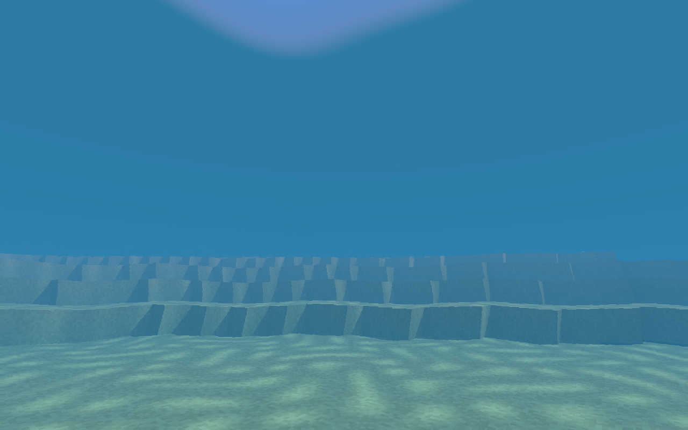
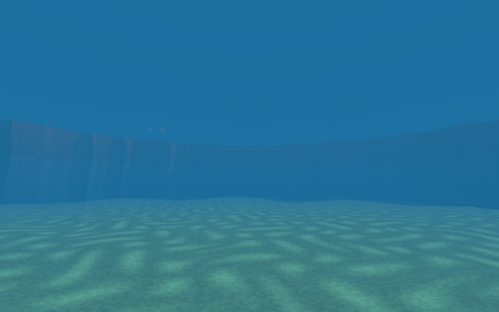

# Results

Measured on an Apple M3 Max, macOS 26.6.1, March main `1a4251bc8` (0.7.0),
release builds. Times use the millisecond wall clock, so a per-chunk figure
is a total divided by a count; "worst" is the slowest single chunk in whole
milliseconds.

## The headless demo (`demo/`, seed 7)

| | Run A: 1 m voxels, radius 6 x 3 | Run B: 10 cm voxels, radius 3 x 2 |
|---|---|---|
| chunks loaded | 1274 | 245 |
| uniform / paletted / direct | 1038 / 236 / 0 | 178 / 67 / 0 |
| voxel storage | 8040 KB, 6462 bytes a chunk | 2280 KB, 9532 bytes a chunk |
| terrain, a chunk | 0.29 ms (worst 5) | 0.35 ms (worst 1) |
| mesh, a chunk, all meshable chunks | 1.42 ms over 660 (worst 14) | 2.23 ms over 75 (worst 6) |
| mesh, a chunk, chunks that draw something | 4.1 ms over 156 | 3.89 ms over 35 |
| quads / instances | 89 222 / 8 950 | 15 529 / 1 317 |
| mesh bytes | 766 KB, 8 bytes each | 131 KB, 8 bytes each |
| single block edit, until its meshes are back | 7 ms, 4 chunks | - |
| sphere edit, until its meshes are back | 8 ms, radius 12, 4 chunks | 14 ms, radius 20, 8 chunks |
| edited chunks in the cache | 0 (all still loaded) | 0 |
| world hash | 84790968213238 | 15643685159536 |

Run A streams a 256 m walk in 64 steps (about 1.2 s in all). Both world
hashes are identical across two executions. `docs/demo-surface.png` is the
top-down picture run A writes: terrain, ponds, plants, lamps, and the
crater the sphere edit leaves.

A flat byte array would be 32 768 bytes a chunk; uniform chunks bring the
average to a fifth of that at metre scale.

## The viewer (`viewer/`, radius 10 x 3, streamed)

| | |
|---|---|
| chunks streamed at startup | 3087 (101 million voxels) in 1.27 s, generation and meshing on tasks |
| quads on the GPU | 361 819 in 2.8 MB |
| drawn after culling, opening view | 117 chunks, 94 392 quads |
| frame rate | 118-120 fps, the display's vsync cap |

`docs/streamed-world.png` is that opening view, with one sphere carved by
a scripted click. The frame rate is capped by presentation, so it says
only that the frame fits in 8.3 ms with room to spare; an uncapped figure
needs a present mode the first slice does not offer.

## Against cube_forge

The design asks for a comparison on equal voxel volume against the most
recent cube_forge entry whose mesher shades corners. That entry is
"Light is sampled per fragment from a 3D texture now" in cube_forge's
`RESULTS.md`: 377 ms to mesh all 144 chunks of 16 x 256 x 16, giving
334 878 vertices. One such chunk is 65 536 voxels, two Strata chunks.

| per 65 536 voxels of world | cube_forge | Strata |
|---|---|---|
| mesh time | 2.6 ms | 2.8 ms (two chunks at 1.42 ms) |
| mesh memory, per quad | 240 bytes (6 vertices of 10 floats) | 8 bytes |
| voxel memory | 65 536 bytes | 12 924 bytes (run A average) |

Two things make the time row inexact, and they pull in opposite
directions. cube_forge's figure is wall time for a parallel pass over
several scheduler threads; Strata's is one thread. And cube_forge's mesher
in that entry no longer carries corner shading in its merge key (light
moved to the fragment shader), while Strata's does. On this evidence
Strata is not faster at meshing per voxel; it is at rough parity on one
thread. The gains are in memory: thirty times less per quad, five times
less per stored voxel.

Single-edit latency is 7 ms, under the 16.7 ms frame the design names as
the point where sub-chunk dirty regions would be needed. They are not
built.

## Where the mesher's time goes

A chunk that draws something costs about 4 ms; a non-uniform chunk that
ends up with nothing to draw about 0.5 ms, which is the fixed cost of the
padded 34-cubed grid. Two changes got there from 5.25 ms and 1.5 ms: the
centre of the padded grid is copied straight from the chunk instead of
through the neighbourhood lookup, and per-layer tallies skip any slice
that has no cube block or looks into a fully solid layer. What remains is
the mask build for live slices and two whole-chunk passes (occupancy and
instances) that could read the padded grid instead.

# Renderer plan

## Baseline before the renderer work (Task 1)

Scene 1 (overview), radius 10 x 3, 2560 x 1600, immediate present mode
requested, CPU frustum culling and one draw per chunk layer:

| | |
|---|---|
| frame rate | 120 fps: still capped by the display |
| draw calls | 242 |
| chunks / quads drawn | 117 / 94 389 |
| GPU time, by timestamp query | 0.5 to 1.1 ms |
| time inside `frame` | 6 to 7 ms, almost all of it blocked in submit |

MoltenVK accepts the immediate present mode and the swapchain reports it,
but the frame still paces to the display: the block moves from the fence
wait into `vkQueueSubmit`, where the driver takes the next drawable. Three
MoltenVK settings were tried and none lifts it. Timestamp queries do work,
so GPU time is real. An uncapped CPU figure needs a frame that never
touches the swapchain; Task 2 adds an offscreen mode for that.

## Two frames in flight and an offscreen timing mode (Task 2)

Uploads and frees no longer wait for the GPU: a released range is held two
frames and then reused. With `STRATA_OFFSCREEN=1` a frame renders to an
image the size of the window and is never presented, so nothing paces it.

Scene 1, radius 10 x 3, 2560 x 1600, offscreen, still CPU culling and one
draw per chunk layer:

| | |
|---|---|
| frame rate | about 3000 fps |
| CPU time in the shim | 0.08 to 0.09 ms |
| GPU time, by timestamp query | 0.2 to 0.3 ms |
| draw calls | 242 |

So at this scene size the old path is nowhere near a limit; the GPU-driven
path that follows is about scaling to many more chunks, not about this
number. With the quad buffer cut to 20 000 quads the same scene refuses
232 uploads and carries on without a crash.

## The chunk table, compute culling, indirect draws (Task 3)

Compute shaders and multi-draw indirect both work on MoltenVK. The open
question was what a command that draws nothing costs. Measured offscreen
on scene 1 with a FIXED command list (one command per slot per range,
zero count when culled) and extra empty commands appended to each of the
three indirect calls:

| extra empty commands per call | frame rate | CPU in the shim | GPU |
|---|---|---|---|
| 0 (9 261 commands in all) | 1 480 fps | 0.46 ms | 0.49 ms |
| 10 000 | 345 fps | 2.87 ms | 1.7 ms |
| 50 000 | 78 fps | 12.9 ms | 6.9 ms |

That is about 84 ns of CPU and 43 ns of GPU per command, drawn or not:
MoltenVK replays a multi-draw as one Metal draw per command. The design's
rule was to compact if 50 000 empty commands cost more than 0.5 ms; they
cost 12.5 ms. So the list is COMPACTED: the compute pass packs visible
commands to the front through an atomic counter and records which slot
each belongs to, the CPU zero-fills the length it is about to submit, and
it reads the counters back to choose the next length (what was seen, plus
a quarter, plus 256). With two frames in flight the count it reads is two
frames old, not one as the design sketched; if a pass overflows its
allowance the next submit covers every slot, so nothing stays missing
beyond two frames.

Scene 1 offscreen with the compacted list: 1 950 fps, 0.28 to 0.31 ms of
CPU in the shim, 3 draw calls. Most of that CPU is the translucent range,
which is still one command per slot (3 087 of them) until Task 6 gives it
its own short sorted list.

## Translucent order (Task 6)

Two see-through walls in different chunks, red glass and water, looked at
from each side: before, the wall drawn last was whichever had the higher
slot, so from one side the far wall tinted the near one. Now the shim keeps
a list of the slots that hold translucent quads, tests and sorts just that
list far to near each frame, and writes its commands itself, into a region
of the command buffer each frame in flight owns.

| | |
|---|---|
| chunks with translucent quads in view, scene 1 | 18 |
| time to test, sort and write them | 4 microseconds |
| CPU in the shim, scene 1 offscreen | 0.10 ms (was 0.28 with one translucent command per slot) |
| frame rate, scene 1 offscreen | about 2 240 fps |

Translucent quads also draw from both sides now, so a water surface is
visible from underneath. Quads inside one chunk are still unsorted.

## The renderer plan, measured (Task 10)

Scene 1 (overview), radius 10 x 3, 2560 x 1600, release build, M3 Max.

| | |
|---|---|
| chunks streamed at startup | 3087 in 0.89 s |
| quads on the GPU | 397 265 in 3.1 MB (plus cross instances and loose quads) |
| draw calls a frame | 5: opaque, cutout, crosses, models, translucent |
| drawn after culling | 117 chunks, 112 291 quads |
| frame rate, offscreen | about 2 000 fps |
| CPU in the shim | 0.17 ms |
| CPU in March (tick and sync, nothing arriving) | 0.01 ms |
| GPU time, by timestamp query | 0.43 ms |
| translucent chunks ordered | 18 in 5 microseconds |

The driver gives timestamp queries, so GPU time is measured, not inferred.
"Vsync off" could not be measured as planned: MoltenVK paces presentation
to the display even in the immediate mode, so uncapped figures are taken
offscreen, where a frame is rendered and never presented.

### The soak run

`scripts/soak.sh`: 3000 frames round a 150 m circuit at 36 m/s with vsync
on, a sphere carved every 100 frames.

    soak: frames=3000 worst_ms=14.41 mean_ms=8.34 refused=0 waiting=0 slots=2200 live_quads=496835 loaded=3381

No frame over 16.7 ms across four runs (worst 14.4 to 16.3 ms). It did not
start there. The first run's worst frame was 25.8 ms, 21 ms of it in March,
and three changes to `Strata.Stream` followed:

- the wanted-and-missing queue is built in one pass over the box instead
  of one pass per distance ring, and the mesh to-do list is looked at once
  per chunk instead of once per mention (an arriving chunk mentions 27);
- a generated chunk's hash is computed by the worker that generated it,
  not on the caller's thread when it is inserted;
- tasks are collected two ticks after they start, not one. A hard chunk
  takes 14 ms or more to mesh, and waiting for it after one frame was the
  dropped frame.

What remains: the frame in which the camera crosses into a new chunk
spends 5 to 7 ms in March rebuilding the queue and unloading the far slab.
It fits in a frame at 120 Hz with little to spare, it is work proportional
to the loaded chunks, and it will grow with the far field. The far-field
plan has to make it incremental.

With a quad buffer smaller than the scene (`scripts/soak.sh 200000`) the
run finishes cleanly with 359 meshes still waiting, as it must; each
waiting mesh is retried every frame, which is wasteful and is noted for
later.

### Against the design's targets

| target | result |
|---|---|
| draw calls per frame constant | met: 5 |
| flying at 40 m/s, vsync on, no frame over 16.7 ms | met at radius 10: worst 14.4 to 16.3 ms |
| CPU in the shim under 0.5 ms | met at 3087 chunks: 0.17 ms. The 8400-chunk scene is the far-field plan's |
| 240 fps standing still at the 5 km view | not yet measurable: no 5 km view. About 2 000 fps offscreen at radius 10 |
| GPU memory for quads under 64 MB at the 5 km view | not yet measurable. 4 MB at radius 10 |

### After the review

The review's fixes (a copy of the uniform block and chunk table per frame
in flight, whole-chunk uploads, the model lighting fix) left the numbers
where they were: scene 1 offscreen about 1 970 fps with 0.17 ms in the
shim, and the soak at

    soak: frames=3000 worst_ms=14.47 mean_ms=8.33 refused=0 waiting=0 slots=2200 live_quads=496835 leaked=0 loaded=3381

# Lighting plan

## The deferred passes, shading unchanged (Task 1)

The renderer now draws in three passes: geometry into screen-sized buffers,
a full-screen light pass, and a final pass that puts the lit image on
screen and draws translucent surfaces over it. In light mode 0 the light
pass computes exactly the old shading, and all 13 golden scenes match the
stored images to within one level in 255.

Scene 1 offscreen: about 1 500 fps, 0.60 ms of GPU (was 0.44 forward) and
0.21 ms of CPU in the shim.

## Task 2: the light volume

One byte per voxel for every chunk the stream holds, a coarse copy at one
eighth the resolution, and a per-chunk owner table. Sized from the stream's
radii: (2 rh + 3) x (2 rv + 3) x (2 rh + 3) chunks.

| stream radius | volume | memory |
|---|---|---|
| 6 x 3 | 15 x 9 x 15 chunks | 66 MB |
| 8 x 3 | 19 x 9 x 19 chunks | 106 MB |
| 10 x 3 (viewer default) | 23 x 9 x 23 chunks | 156 MB |

The design's 128 MB target is missed at the viewer's default radius; it is
met at radius 8. A frame copies at most 128 chunks into the volume; the rest
wait for the next frame. The soak with the volume in place: worst frame
16.6 ms, mean 8.3 ms, nothing refused or leaked. Golden scenes `volume` and
`volume-walk` draw the volume's classes over the overview and after a walk
(wrap addressing): the terrain's shape, no holes, no wrapped copies.

## Task 4: sun shadows (light mode 2)

2560 x 1600, offscreen, the overview at stream radius 10.

| | GPU time |
|---|---|
| mode 1, no rays | 0.66 ms |
| mode 2, sun at 55 degrees | 1.74 ms |
| mode 2, sun at 15 degrees | 2.60 ms |

The 2 ms target is met with a high sun and missed by 0.6 ms with a low one,
where rays skim the ground for longer. What got it there, from 10.4 ms:
empty chunks are crossed whole (the owner table marks them), the walk no
longer wraps coordinates at every step, and a pixel whose memory has settled
takes a new sample one frame in four, in 8-pixel blocks (a finer pattern
saved nothing: the GPU shades neighbouring pixels together).

An edit: the slab's shadow is at full darkness on the first frame the slab is
drawn, and gone on the first frame it is not (goldens `shadow-placed`,
`shadow-removed`, shot four frames after the edit). Stillness: frames 118 and
119 of the forest differ by more than 4 in 0.0017% of pixels (limit 0.05%).

## Task 5: sun highlight and reflections (light mode 3)

2560 x 1600, offscreen, stream radius 10.

| scene | GPU time |
|---|---|
| overview, sun 30 | 2.61 ms |
| high ground (snow and ice), sun 30 | 1.72 ms |
| lake filling half the screen, sun 12 | 7.0 ms |

Water is the expensive case: every water pixel traces a sun ray and a mirror
ray every frame, with no memory between frames. Two changes to the ray walk
made along the way also brought mode 2 down to 1.43 ms (sun 55) and 1.96 ms
(sun 15), inside its 2 ms target: a coarse cell and a chunk now record how
high their contents reach, and a rising ray above that crosses them whole.

## Task 6: sky light, emission and one bounce (light mode 4, the default)

2560 x 1600, offscreen, stream radius 10, two sky rays a pixel a sample.

| scene | GPU time | frame rate |
|---|---|---|
| overview, sun 35 | 4.3 ms | about 230 fps |
| forest floor | 4.0 ms | |
| high ground, snow and ice | 3.4 ms | |
| lantern at dusk | 4.2 ms | |
| lake filling half the screen, sun 12 | 9.7 ms | about 100 fps |

The 6 ms target is met everywhere except with a lake filling the view, where
the 120 fps target is missed too. The cost there is the water itself: each
water pixel traces a sun ray and a mirror ray every frame, in the final pass,
which a half-resolution light pass would not touch. So the light pass stays
at full resolution, and `Strata.Render.set_quality(sky_rays, reflections)`
is the lever: without mirror rays the lake costs about 7 ms.

Stillness (frames 118 and 119, share of pixels differing by more than 4,
limit 0.05%): shadows only 0.0017%; everything on, daylight forest 0.0325%;
lantern light at dusk 0.68% after two seconds and 0.07% after ten. Light from
a small lamp is found by few rays, so it takes longer to settle than the
one-second target.

## Task 7: lighting, measured against its targets

The overview offscreen at 2560 x 1600, stream radius 10, by light mode:

| mode | what it adds | GPU | shim CPU | frame rate |
|---|---|---|---|---|
| 0 | the old flat shading | 0.65 ms | 0.25 ms | 1333 fps |
| 1 | sky and sun, no rays | 0.68 ms | 0.23 ms | 1338 fps |
| 2 | sun shadows | 1.64 ms | 0.49 ms | 614 fps |
| 3 | highlight and reflections | 1.77 ms | 0.42 ms | 533 fps |
| 4 | sky light, emission, one bounce | 4.13 ms | 0.50 ms | 232 fps |

| target | result | |
|---|---|---|
| GPU, sun shadows only: 2 ms | 1.4 to 2.0 ms | met |
| GPU, everything on: 6 ms | 3.4 to 4.6 ms; 9.7 ms with a lake filling the view | met, except the lake |
| frame rate, everything on: 120 fps | 232 fps; about 100 fps with a lake filling the view | met, except the lake |
| lighting follows an edit: 2 frames | the frame the edit is drawn | met |
| light volume memory: 128 MB | 156 MB at radius 10 x 3, 106 MB at 8 x 3 | missed at the default radius |
| settles within 1 second | daylight yes; lantern light at dusk takes about ten | missed for small lamps |

Causes of the misses: the lake is each water pixel tracing two rays every
frame with no memory between frames; the volume covers the whole stream box
at a byte a voxel; a small lamp is found by few of a pixel's rays.

The soak (`scripts/soak.sh`, light mode 4): nothing refused, nothing waiting,
nothing leaked. Its 20 ms worst-frame limit could not be judged in this run:
the machine was under a load average of 35 from other work, and the run with
lighting off (26 ms) was as slow as the run with it on (25 to 33 ms). The
last quiet run, with the light volume in place, was 16.6 ms.

Screenshots: `docs/light-lake.png`, `docs/light-shore.png`,
`docs/light-snow.png`, `docs/light-forest.png`, `docs/light-lantern.png`.

# Fluid plan

## Tasks 4 and 5: a lake drains in the viewer

The test lake (seed 7): radius 22, 7 deep, 10 280 voxels, its bed 12 voxels
above the ground outside its rim. Breached at frame 30 by a channel of carve
spheres through the rim down to its bed. Ten fluid steps a second, each
worked out on a worker and applied six frames later.

| | target | result | |
|---|---|---|---|
| CPU per fluid step at the cap | 2 ms | about 5 microseconds a cell on a worker: 4 ms at 800 active cells, about 20 ms at the cap | missed |
| what a step costs the frame | (none set) | 0.2 to 0.5 ms | |
| lake empty | 2 minutes | 5.5 minutes | missed |
| what is left | under 2%, no cell over an eighth | 3.1%, a film of a few eighths on the bed | missed |
| at rest after the last change | 5 seconds | no active cells from the step after the last move | met |
| water conserved | exactly | exactly (property tests) | met |

Why the drain is slow: water leaves only over the lip of the outlet, a few
cells wide, at up to eight eighths a cell a step. The rest of the lake stays
level and feeds the lip by evening out. An earlier rule let every surface
cell within reach send its water straight to the outlet; it drained no
faster (the lip was still the limit) and tore holes in the surface.

Why a film is left: a cell evens out only with cells two or more eighths
lower, so a wet bed keeps up to an eighth or two a cell, and a single eighth
never moves on flat ground.

The lake used is 10 000 voxels, not the planned 20 000: of the lakes near the
origin for seed 7 it is the largest whose bed is above the ground outside,
so that a breach can drain it at all.

## Task 6: spray

A ring of 65 536 particles, ten floats each, flown by the clock in the
vertex shader; one draw (two where the ring wraps), only when any are live.

| | GPU time | frame rate |
|---|---|---|
| overview, everything lit, no particles | 5.87 ms | 165 fps |
| the same with the ring full (65 536 live) | 6.17 ms | 156 fps |

Measured with the machine under a load average of 29, so both rows are slow;
the difference, 0.3 ms for a full ring, is what the particles cost. The
target (50 000 live at 120 fps or better) is met.

## Task 7: fluids, measured against their targets

| target | result | |
|---|---|---|
| CPU per fluid step at the cap: 2 ms | about 5 microseconds a cell on a worker, so about 20 ms at the cap of 4096 (extrapolated: the test lake never passed 1500 cells) | missed |
| what a step costs the frame | 0.2 to 0.7 ms presenting; up to 3.5 ms offscreen, where six frames are shorter than the worker's step and the frame waits for it | no target was set for this |
| active cells a step (cap): 4096 | never reached by the test lake (about 1500 at most) | not exercised |
| worst frame while a lake drains: 16.7 ms | 15.9 ms (soak, offscreen, 3000 frames, everything lit) | met |
| lake empty: 2 minutes | 5.5 minutes for 10 280 voxels | missed |
| what is left: under 2%, no cell over an eighth | 3.1%, a film on the bed | missed |
| at rest: within 5 seconds of the last change | on the next step | met |
| water conserved | exactly, in every property test; the soak's lake only ever falls | met |
| 50 000 live particles at 120 fps | a full ring of 65 536 costs 0.3 ms of GPU time | met |

What moving water costs the lighting, offscreen at 2560 x 1378 (the display
this was run on is smaller than the 2560 x 1600 used before):

| view | GPU, water at rest | GPU, lake draining |
|---|---|---|
| over the lake | 6.7 ms | 9.2 ms |
| the valley below, waterfall in view | 3.3 ms | 8.2 ms |

Each fluid step is an edit, and an edit makes nearby pixels sample every
frame instead of one in four until they settle; with water moving ten times
a second they never do. This is the largest cost fluids add.

The soak now circles the test lake, breaches it at frame 300, and runs
offscreen by default: presenting to a display that is asleep or hidden,
MoltenVK holds a frame for a whole second.

Found on the way (GAPS S15): passing the shared block registry into the
mesher's per-face function made meshing seven times slower. The soak caught
it; chunk streaming is back to 0.27 s for 1183 chunks.

## After the review

The step target was first reported as met against the wrong measure. The
design's target is the CPU a step takes; moving the step to a worker made it
cheap for the frame, not cheap. Near the cap the frame would wait for the
worker, which is the hitch the design names. The fix is a cheaper step, and
that is a rewrite of how the step keeps its cells; it is not done.

The review found two faults in the rules, both fixed: a cell whose landing
place was taken by another fell out of the active set with its water still
in the air, and an edit made while a worker step ran was forgotten when it
touched a cell that was already active.

# Audio plan

Measured on the same M3 Max, release builds. Every run was made while other
sessions kept the machine busy (load averages 24 to 39); the plan trusts a
timing only under 8, so the figures that depend on load are marked not
judged. Nothing here played sound aloud: renders are in game time to WAV
files, and timed runs use miniaudio's null device, which is paced like a
real one.

| target | result | |
|---|---|---|
| `update` to a played sound's first sample in the device's buffer: 20 ms | 11.9 to 19.7 ms on the null device (two 256-frame buffers queued); with three it was 24 to 26 ms, so two are used | met, on the null device; a real device adds its own output latency |
| voices mixed / tracked: 64 / 1024 | 64 / 1024, the quietest at the listener (times priority) virtual; past 1024 the quietest goes and is counted | met |
| mixing thread, 64 rich voices, third-order bus, binaural: 10% of a core | 6.6% (C bench, before the reverb); 8.9% with the reverb, against 8.0% without it in the same busy minute | met, not judged |
| main thread a frame, all of `Strata.Sound`: 0.2 ms | 0.05 to 0.06 ms in 60- and 120-frame soaks; 6.8 ms worst in a 3000-frame soak at load 33 | met when quiet, not judged under load |
| acoustics update, 64 voices x 5 walks plus 64 listener rays: 2 ms on a worker | 0.4 ms in soundcheck's walled world; 1.1 to 1.6 ms on the viewer's terrain | met |
| occlusion follows a move or an edit: 250 ms | within 15 frames of 1/60 s (test "a wall built between listener and sound muffles it within 250 ms") | met |
| C mixer memory, without recordings: 16 MB | 1.8 MB (1024 voices of 968 bytes, 2047 patches, the bus, the reverb's lines) | met |
| decoded recordings: 64 MB, refused past it and counted | as designed; soundcheck's budget scene refuses a 2.3 MB file at 1 MB and counts it | met |
| underruns over a soak with a 100 ms main-thread stall every 600 frames: 0 | 0 in the stalled run; 8 in the 3000-frame run at load 33, whose frames without sound already took 54 ms | met for stalls; not judged under load |
| output peak: never over -1 dBFS | the limiter test: 20 voices of full noise peak at -1.0 dBFS | met |
| added to the soak's worst frame: under 0.5 ms | 54.1 ms without sound, 46.3 ms with it, at load 36 | not judged |

What the soundcheck scenes show, by fingerprint (no listening needed):

| scene | what is measured | |
|---|---|---|
| recording | the tone rendered to a file, loaded back and played, matches the tone within 1.5 dB a band | as designed |
| wall | pink noise passing behind 2 m of stone falls from about -70 to -115 dB and comes back | |
| cave / field | the same strikes: the cave's tail is 25 dB above the field's (-56.7 against -82.2 dB) | the gate asks 10 |
| falls-4 / 12 / 24 | louder (-21.9, -16.3, -10.9 dB) and brighter (4 kHz over 500 Hz: -23.5, -22.1, -19.4 dB) the further the water falls | |
| reverb | an impulse into spaces asked to ring 0.5, 2.0 and 4.0 s decays in 0.51, 2.02 and 4.01 s | C test |

Not listened to yet by the owner: every stored fingerprint was stored from a
render nobody had heard. `scripts/audio_golden.sh --update` writes the WAVs
to listen to.

Headphones use the MIT KEMAR measurements (Gardner and Martin, 1994: 368
directions, compact set), each of 512 virtual speakers taking the nearest,
resampled to 48 kHz and diffuse-field equalised: a diffuse field keeps its
power within 0.65 dB. A source behind sounds duller than one in front by
10.4 dB in the 4 to 8 kHz octave, against 1 to 4 dB from the spherical-head
model used before.

Headphones use filters from a computed spherical head (Woodworth's delay,
Brown and Duda's shadow, a pinna notch that rises with elevation, a lift in
front and a dulling behind), diffuse-field equalised. Measured ears (MIT's
KEMAR set) would place sound more convincingly; fetching them waits for the
owner's yes.

# Light and water together

A pass over how the two behave side by side, after both were built. Scenes
were made to show each question, looked at, and the faults fixed.

| question | found | done |
|---|---|---|
| Does partly full water reflect? | No. Its mirror ray began inside its own voxel, which the light volume holds as full, and stopped there: flat blue instead of a reflection. | Fixed: a mirror ray leaving water passes see-through voxels in the water's own layer and the one above. Golden `water-reflects`. |
| Does a draining surface stay even under light? | No. Cells dropped by up to six eighths in a step and showed as pits with walls. Two causes: a cell evening out could give to four far cells at once, and water under water poured all it had into a shallower neighbour. | Fixed: a cell gives away two eighths a step at most while evening out; water under water pours half the difference into a neighbour that holds some. Tests first. |
| Does moving water unsettle the light around it? | Yes: each fluid step was treated as an edit, so nearby pixels never settled and sampled four times as often. | Fixed: only a change in what blocks or emits light is an edit. Water does neither. |
| Is spray lit sensibly in shade? | No: it took the sun's full light anywhere. | Fixed: a particle takes the sun only where one ray reaches it, and less sky under a roof. Golden `splash-shaded`. |
| Is a tilted water surface lit as tilted? | No, it is lit as level. | Left: per-cell tilts of an eighth would show as facets. |
| Do light rays see partly full water as full blocks? | Yes. | Left: water does not block the sun or sky rays; only reflections OF water in other mirrors are affected. |
| The light and dark patches on a lake at a low sun | The rim's and the trees' shadows on the lake bed, seen through the water. | Correct as it is. Golden `lake-low-sun`. |

What moving water costs the lighting now, offscreen at 2560 x 1600:

| view | GPU, water at rest | GPU, lake draining | before this pass, the difference |
|---|---|---|---|
| over the lake | 7.8 ms | 8.5 ms | 2.5 ms |
| the valley below | 6.8 ms | 7.1 ms | 4.9 ms |

Beside a running stream, two consecutive frames differ by more than 4 in
0.16% of pixels, and those are the water itself.

The even surface has a price: the test lake now takes about 8 minutes to
drain, up from 5.5, with 2.9% left. The 2 minute target was already missed.

Not judged: the soak's frame-time limit. The machine's load average was 54
during this pass (other work), and the soak was as slow with spray off as
with it on. Its other checks pass. The last quiet soak, before this pass,
had a worst frame of 18.8 ms.

Not checked: stillness of lit water at rest, because water ripples by
design; whether many overlapping spray particles, each tracing two rays,
cost too much in a large waterfall.

# In the water

Swimming and an underwater look, on branch `swim`.

- `Strata.Fluid.depth_in`, `flow` and `surface` answer what a game needs to
  move a body in water. The viewer's body floats, swims up, climbs out at a
  bank, is slower in water and is carried by a current.
- `Strata.Render.set_underwater` shows the world through the liquid: fog in
  its colour, less light with depth, sun ripples, the surface from below,
  a swaying view.
- Three new golden scenes: `under-sea`, `under-sea-up`, `under-lake`.

Measured at 2560 x 1600 on a loaded machine (load average 46), so the
numbers are rough.

| view | GPU ms |
|---|---|
| under the sea, looking across | 3.1 |
| under the sea, looking up | 0.4 |
| the shore from above, for comparison | 7.0 |

Not done: bubbles, drifting specks, sound, a water line across the screen
when the eye sits exactly at the surface. The current was tested on a body
in a test world, not judged by playing.

# Interface and text

Branch `interface`. Plan `docs/2026-11-11-ui-text-plan.md`, rulings in
`docs/ui-ledger.md`. Measured on an M3 Max while another session was also
building and testing, so times are rough.

| | target | measured | |
|---|---|---|---|
| GPU time for the viewer's display, 2560 x 1600 | 0.2 ms | 0.03 ms | met |
| CPU time, 200 rectangles and ten lines (about 520 glyph quads), unchanged text | 0.2 ms | 0.09 ms | met |
| the same with every line changing each frame | none set | 0.11 ms | measured before HarfBuzz; not repeated after |
| draw calls added | 1 | 1 | met |
| rasterising in a frame | 1 ms | 1.0 to 1.08 ms | met within a glyph's overshoot |
| a glyph's first use | | about 45 microseconds | |
| text edge | sharp from 8 to 200 px, still | sharp on the sheet; frames 58 and 59 identical | met; 8 and 10 px are unhinted and soft |
| glyph atlas memory | 16 MB | 4 MB after the soak; 16 MB is the ceiling | met |

- The six-script sheet (121 glyphs) is complete after 6 frames.
- Soak, 3000 frames with the display on: nothing dropped, no glyph waiting,
  worst frame 9.5, 30.1 and 12.4 ms in three runs (limit 20) on a loaded
  machine.
- FreeType's own distance-field renderer took 2 to 4 ms a glyph; the field
  is worked out in `strata_text.c` from FreeType's coverage instead.
- Text over 80 pixels uses a second, finer picture of each glyph: nine
  times the atlas room, for corners that stay sharp.

After the review (one independent reviewer, whole branch), fixed with a test
each:

- A frame makes no more new glyph pixels than the renderer uploads in a
  frame, so a glyph is never drawn before its pixels are on the GPU.
- The glyph table forgets evicted glyphs when it fills, so new glyphs are
  still drawn after tens of thousands have come and gone.
- Text written into a display no longer shows through in another display
  built from the same starting one.
- Loading a font again, or setting the same fallback list, no longer
  forgets every remembered layout.
- The soak's "no glyph waiting" check reads the frame that just ended; it
  could not fail before.
- A glyph that finds no room is tried about once a second, not every frame.

Not done: the comparison against macOS's own text rendering; a test of the
upload path on the GPU; wrapping right-to-left text is checked by a probe,
not by the suite.

After the review fixes the soak's worst frame was 54.2 and 49.0 ms in two
runs, with a load average of 40 from another session building on the same
machine (mean 8 to 11 ms). The frame-time limit is not judged: rerun
`scripts/soak.sh` on a quiet machine. Every other soak check passed.

# Animation plan

## Task 5: cost control and two poses, measured headless

`scripts/anim_check.sh` runs the scenes. `arena` runs 512 figures of a
15-part humanoid with 3 layers, an aim on the spine and head, and both legs
reaching for moving targets, at 1/60 s updates for 10 s. About half the
crowd is outside the view. `ground128` runs `Strata.Anim.ground` for 128
figures over hills. `hits` adds 10 000 rays in the arena after 60 updates.
Update and ray times come from the monotonic clock in the C shim (C only).
The ground time is March's millisecond clock over 120 frames, less the
updates' C time.

Load averages were 75-79 during the three runs below (31-48 in earlier runs),
from other sessions building on the same machine. That is well over 8, so **no
timing here is judged**. Each number is the range over three runs at 20:55.
Rerun `ANIMCHECK_SCENE=arena|ground128|hits
animcheck/.march/build/release/animcheck` on a quiet machine to judge them.

| | target | measured | |
|---|---|---|---|
| `Strata.Anim.update`, arena, half out of view (C) | 1.0 ms | mean 0.86-0.95 ms; worst 24.8-38.5 ms (load) | not judged; mean under the target |
| `Strata.Anim.ground`, 128 figures, 2 legs (March) | 0.5 ms | 0.94-1.28 ms a frame | not judged; above the target |
| hit ray, arena, mean of 10 000 (C) | 10 µs | 0.5-0.6 µs (0.6-0.7 µs through `Strata.Anim`) | not judged; far under the target |

- **Update.** With no view the same arena takes a mean of 1.07-1.50 ms.
  About 182 of the 512 figures skip each update: the half out of view, three
  updates in four. The worst update is load: the no-view worst was 1.19 ms in
  the quietest run, and 21-38 ms in the others.
- **The first query after an update** poses every figure that update skipped
  (185 here), in 0.40-0.41 ms (0.81-0.88 ms at load 30). That keeps answers
  independent of the camera. The cost is that a game asking one ray each
  update gets the posing back in that query; only frames that ask nothing
  save it.
- **Ground.** `ground_targets` alone (the feet's animated origins and 256 rays
  through `Strata.Query.raycast`) takes 0.60-0.68 ms a frame, more than the
  whole target. The rest of `ground` (the knees' origins, the facing, the rig
  lookup, the reach and drop calls) adds about 0.35-0.6 ms. The cause is
  March's per-ray and per-call cost, measured, not chased. The design's
  fallbacks are, in order, one ray per leg every other frame, then fewer
  figures. 121 of the 128 figures stand with both soles within 0.03 m of the
  hills.
- **Rays.** These rays run from 0.2-2.6 m up in front of the crowd toward a
  figure 0-2 m up, and 9 562 of 10 000 hit. Most stop at the first figure in
  their way, which is why they are cheap.
- **Memory** at 4 096 figures (sizeof, decimal MB), rigs excluded: 46.34 MB,
  leaving 1.66 MB under 48 MB.
  - Figures 7.90 (AnFig 1 928 B), matrices 12.58, previous matrices 12.58.
  - Keys 5.51, clips 2.21, rigs 0.87, masks 0.07, marks 0.26, events 1.31.
  - Ids 0.05, procedural pool 1.70, hit grid 0.38, draw list 0.92 (16 384
    parts).
  - Counting the rig data too (sockets 0.26, part grids 2.51) gives 49.11 MB.
- **Drawing.** A figure posed every few updates is drawn with its blend
  stretched over that period, one period behind its pose (review fix I1).

# Entities

Measured on the same M3 Max, release builds, headless (`entcheck`). The
plan trusts a timing only under load 8; every figure here was taken while
other sessions kept the load far above it, so none is judged.

| scene | median | worst | target | verdict |
|---|---|---|---|---|
| storm: 20,000 flying bullets, all seen, one touch pair against 200 targets; `step` over ticks 200 to 600 | 2.47 ms (2.57 in the run before) | 40.2 ms (97.1) | 2 ms | not judged (load 20 to 35) |
| 5,000 removed and 5,000 added between two ticks, then the step | 1.11 ms for the 10,000 calls from March; 2.76 ms the step after | one run | 1 ms | not judged (load 20 to 35) |

The storm fires its bullets from four emitters 50 m from the centre in rings
of 64 at 40 m/s; each falls to the floor or meets a target within about a
second, and the game replaces every bullet named in a touch or a block hit
(about 350 a tick; 228,518 fired in 601 ticks, 28,973 touches). Its touch
events equal a brute-force count on ticks 150 (59) and 300 (60), and two runs
end on one hash.

Where the step goes, from a C bench of a like scene (best of 20 ticks, cc -O2,
same machine, load about 50): 1.12 ms a tick, of which 0.87 ms is the 20,000
bullets' rays through the voxel copy (0.25 ms with all unseen, so no rays),
0.18 ms building the grid and 0.01 ms the touch pairs.

# The fluid step in flat arrays

On branch `cost`. The fluid step's bookkeeping moved from persistent maps
and lists to native arrays, in March. The rules a cell follows (`decide`,
`scan`, `share` and the rest) are unchanged.

- The cells a step touches sit in one native array, 12 ints a cell, found
  by a hash of their position (`Strata.Fluid.Tab`). Offers are chained per
  target in a second array and settled target by target.
- The chunks round a step's cells are fetched from the world once a step
  (`Strata.Fluid.Reader`); every block read went through the world's chunk
  map before.
- The cells left active travel between steps as a flat array
  (`Strata.Fluid.Cells`), not a map.
- A version in C was written first and measured, then dropped: the user
  chose to keep the engine in March.

Time per active cell per step, `forge bench fluid`, old and new run in
turn on a machine with a load average near 30:

| version | 48 x 48 water | 64 x 64 water |
|---|---|---|
| maps and lists (before) | 5.6 to 5.9 µs | 6.0 to 6.2 µs |
| flat arrays (now) | 2.4 to 2.7 µs | 2.5 to 2.7 µs |
| flat arrays, scans with SIMD | about 3.5 µs | about 3.5 µs |
| C, measured earlier | 0.8 to 1.0 µs | 0.8 to 1.0 µs |

SIMD was tried on the four sideways scans, one lane a direction. March has
no gather, so the blocks are still read one at a time; packing the lanes
cost more than the shared comparisons saved, and it was taken out.

What is left of a step's time is spread: block type lookups, reference
counting, the planning views. The compiler costs found on the way (array
reads that are calls, `||` that does not short-circuit) are GAPS S26 to S28;
a fix to the March compiler is under way apart from this branch.

The viewer steps fluids 30 times a second (`STRATA_FLUID_HZ`), up from
10, so a dug-out lake drains three times sooner.
